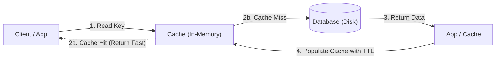
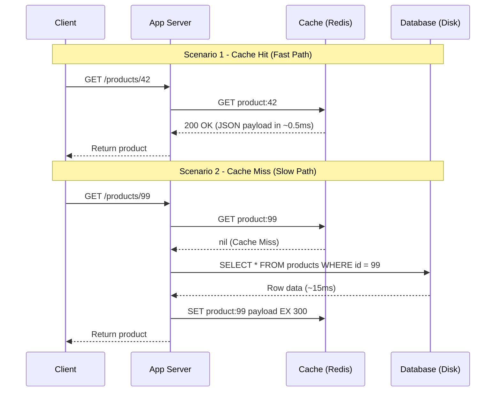
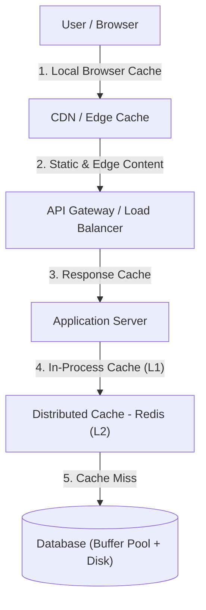

# The Problem: Why We Need Caching

Caching is the practice of storing copies of frequently accessed or expensive-to-compute data in a high-speed storage layer (typically RAM) so future requests can be served in microseconds instead of hitting slower disk-based databases or recomputing from scratch.

---

## Contents

- [What is Caching?](#what-is-caching)
- [The Problem: Why Caching Matters](#the-problem-why-caching-matters)
  - [Real-World Scale](#real-world-scale)
  - [What Breaks Without a Cache](#what-breaks-without-a-cache)
  - [Latency Numbers Every Engineer Should Know](#latency-numbers-every-engineer-should-know)
- [How Caching Works](#how-caching-works)
  - [Cache Hit vs Cache Miss](#cache-hit-vs-cache-miss)
  - [Core Metrics and Terminology](#core-metrics-and-terminology)
- [HLD: Where Caching Lives in a System](#hld-where-caching-lives-in-a-system)
- [LLD: Core Design Considerations](#lld-core-design-considerations)
  - [Cache Key and Value Design](#cache-key-and-value-design)
  - [Capacity Estimation (Back-of-the-Envelope)](#capacity-estimation-back-of-the-envelope)
  - [Data Structure Expectations](#data-structure-expectations)
- [When NOT to Cache](#when-not-to-cache)
- [Summary](#summary)

---

## What is Caching?

Think of a chef working in a busy restaurant kitchen. Instead of walking to the basement walk-in freezer every time a dish needs salt, oil, or chopped garlic, the chef keeps small bowls of those ingredients right on the prep counter. Reaching for salt on the counter takes 1 second; walking to the freezer takes 2 minutes.

In software systems, the **database on disk** is the walk-in freezer, and **in-memory cache (RAM)** like Redis or Memcached is the prep counter.

Fetching data from disk or querying relational databases repeatedly introduces latency and consumes computing resources. A fast memory-based cache serves requests at sub-millisecond latencies while protecting downstream databases from overload.

---

## The Problem: Why Caching Matters

Most real-world applications are **read-heavy**. Users read data far more often than they write or update it (often 10:1, 100:1, or even 1000:1).

### Real-World Scale

1. **Social Media (Instagram / X)**
   When a celebrity with 100 million followers posts a photo or tweet, millions of users request that exact same post and profile metadata within seconds. Running the same `SELECT * FROM posts WHERE id = 123` query millions of times per second against a relational database would crush it instantly.

2. **E-Commerce (Amazon / Flipkart)**
   During a flash sale, millions of shoppers refresh the same product page, price, and review summary. The product title, description, and images barely change, yet every page load without a cache triggers multiple database `JOIN`s.

3. **Expensive Computations & Aggregations**
   Computing a gaming leaderboard, a personalized Netflix homepage row, or a complex analytics dashboard might take 500 ms to 2 seconds of CPU and DB work. If 10,000 users view the same global leaderboard every minute, recomputing it for every request wastes massive compute.

### What Breaks Without a Cache

If every read request goes straight to your primary database:

1. **High Latency:** Disk seeks, query parsing, lock acquisition, and multi-table `JOIN`s add tens of milliseconds per request.
2. **Database Bottleneck & Connection Exhaustion:** Databases have strict limits on concurrent connections and IOPS (Input/Output Operations Per Second). A sudden traffic spike fills the connection pool, causing requests to queue and time out.
3. **Wasted Compute:** The database repeatedly executes identical queries and serializes identical results for data that hasn't changed.
4. **High Infrastructure Cost:** Scaling a primary relational database (vertical scaling or adding read replicas) is far more expensive and operationally complex than placing a memory cache in front of it.

### Latency Numbers Every Engineer Should Know

Understanding the speed difference between storage layers explains why caching is non-negotiable in system design interviews:

| Operation | Approximate Latency | Relative Speed |
|-----------|---------------------|----------------|
| L1 / L2 CPU Cache Reference | ~1 to 5 ns | Instant |
| Main Memory (RAM) Read | ~100 ns | ~100x slower than CPU cache |
| Redis / Memcached (Over Local Network) | ~0.2 to 1 ms | Fast network hop + RAM read |
| SSD Random Read | ~100 us (0.1 ms) | ~1,000x slower than RAM |
| Relational DB Query (Indexed + Network) | ~5 to 20 ms | ~50x slower than Redis |
| Complex DB Query (JOINs / Aggregations) | ~50 to 500 ms | ~500x slower than Redis |
| Cross-Region Network Round Trip | ~50 to 150 ms | Slowest |

> Notice that reading from an in-memory cache like Redis is often **10x to 100x faster** than running a database query, and frees the database from doing disk I/O and CPU work.

---

## How Caching Works

At its core, caching intercepts a read request before it reaches the database.

### Cache Hit vs Cache Miss

Here is how both paths play out step by step:

### Core Metrics and Terminology

| Term | What it is |
|------|------------|
| **Cache Hit** | Requested data is found in cache storage and returned immediately. |
| **Cache Miss** | Requested data is not in the cache and must be fetched from the underlying database (or recomputed). |
| **Cache Hit Ratio** | Percentage of requests served from the cache: `Hits / (Hits + Misses)`. High-performing caches target 90% to 99%. |
| **Miss Penalty** | Extra latency incurred on a cache miss (cache lookup + DB query + writing back to cache). |
| **TTL (Time-To-Live)** | Expiration duration after which a cached entry is automatically deleted or considered stale. |
| **Working Set** | The subset of total data that is actively accessed during a given time window (often follows the 80/20 rule: 80% of traffic hits 20% of data). |
| **Cold Start** | State when a cache is empty (after deployment or restart), causing a spike in cache misses and heavy DB load. |
| **Cache Warming** | Pre-populating the cache with hot keys before routing live user traffic to avoid a cold start. |

---

## HLD: Where Caching Lives in a System

In a High-Level Design (HLD) interview, caching is rarely a single box. Modern distributed systems use **multi-layer caching**, where each layer absorbs traffic closer to the user.

| Layer | Where It Lives | What It Stores | Typical Latency | Examples |
|-------|----------------|----------------|-----------------|----------|
| **Client / Browser Cache** | User's device | Images, CSS, JS, static API responses (`Cache-Control` headers) | ~0 ms (local disk/RAM) | Chrome HTTP cache, Mobile local storage |
| **CDN (Edge Cache)** | Edge servers near users | Static assets, public pages, video chunks, edge API responses | ~5 to 30 ms | Cloudflare, CloudFront, Akamai |
| **API Gateway / Reverse Proxy** | Network perimeter | Full HTTP responses for identical public GET requests | ~1 to 5 ms | NGINX, Varnish, Kong |
| **In-Process / Local Cache (L1)** | App server's own RAM | Ultra-hot, small config/reference data (no network hop) | ~100 ns (in-memory) | Caffeine (Java), Guava, Node `Map` |
| **Distributed Cache (L2)** | Dedicated cache cluster | Shared session state, user profiles, leaderboards, DB query results | ~0.5 to 2 ms | Redis, Memcached |
| **Database & OS Cache** | Inside DB engine / OS | Recently read disk pages, B-tree index nodes | ~0.1 to 1 ms | InnoDB Buffer Pool, PostgreSQL Shared Buffers, OS Page Cache |

> **Interview Tip:** Combining **L1 (Local)** + **L2 (Distributed)** is called **Two-Level Caching**. L1 eliminates network hops for ultra-hot keys, while L2 acts as the shared source of truth across all app server instances.

---

## LLD: Core Design Considerations

In Low-Level Design (LLD) and Machine Coding rounds, interviewers expect you to think beyond "just put Redis in front of the DB."

### Cache Key and Value Design

1. **Structured, Collision-Free Keys:**
   Use a consistent namespace pattern such as `<service>:<entity>:<id>:<version>`.
   Example: `catalog:product:98421:v2`
   Including a version (`v2`) lets you deploy schema changes safely without colliding with old cached objects.

2. **Keep Values Bounded:**
   Never cache unbounded lists or huge multi-megabyte blobs under a single key. Large values saturate network bandwidth and block single-threaded caches like Redis.

3. **Serialization Format:**
   Choose between human-readable formats (**JSON**, easy to debug) and compact binary formats (**Protobuf / MessagePack**, smaller memory footprint and faster parsing at scale).

### Capacity Estimation (Back-of-the-Envelope)

When sizing a cache in an HLD interview, follow this 4-step formula:

1. **Identify Daily Active Users / Read QPS:**
   Suppose an app handles `10,000 QPS` for `GET /tweet/{id}`.
2. **Apply the 80/20 Rule (Working Set):**
   Assume 20% of unique items generate 80% of reads. If there are 50 million active tweets/day, caching the hot 20% means storing `10 million` tweets.
3. **Estimate Average Object Size:**
   If 1 tweet JSON object (with metadata) is `1 KB`:
   `10,000,000 * 1 KB = 10 GB` of RAM needed.
4. **Add Overhead & Replication:**
   Add ~20% for hash table/key metadata overhead (~12 GB), plus replication if high availability is required. One medium Redis node (e.g., 16 GB or 32 GB RAM) easily holds this.

### Data Structure Expectations

In an LLD interview (like *"Design an LRU Cache"*), your cache must support **O(1)** time complexity for both lookups and updates:
- **`get(key)` in O(1):** Requires a Hash Map (`HashMap` / `dict`).
- **`put(key, value)` + Eviction in O(1):** When memory is full, you must know which item to evict in `O(1)` time (e.g., pairing a Hash Map with a Doubly Linked List for LRU).

*(We will dive deep into eviction algorithms like LRU, LFU, and caching patterns in `02-caching.md`.)*

---

## When NOT to Cache

Caching adds complexity (stale data, invalidation bugs, extra infrastructure). Do not cache when:

1. **Data Requires Strong Consistency:**
   Bank account balances, payment ledger states, or final inventory stock deduction during checkout. Reading stale cached data here can cause double spending or overselling.
2. **Write-Heavy or Constantly Mutating Data:**
   If a key is written 100 times for every 1 read, the cache is constantly invalidated before it ever gets a cache hit. You pay the cost of maintaining the cache with almost zero benefit.
3. **Unique / Low-Reuse Queries:**
   One-time search queries, unique audit logs, or random UUID lookups rarely repeat. Caching them pollutes RAM and evicts genuinely hot data.
4. **Tiny Datasets:**
   If your entire database table is 5 MB, modern databases already keep it entirely in their internal RAM buffer pool. Adding an external cache just adds a network hop and sync complexity.

---

## Summary

| Concept | One-liner |
|---------|-----------|
| **Why Caching?** | Eliminates slow disk I/O and repeated DB queries by serving hot data from fast RAM. |
| **Cache Hit / Miss** | Hit = served fast from cache; Miss = fetched from DB and populated into cache. |
| **Hit Ratio** | `Hits / (Hits + Misses)`; measures how effective the cache is (aim for 90%+). |
| **TTL** | Expiry timer on cached data to bound staleness and reclaim memory. |
| **Multi-Layer Caching** | Browser -> CDN -> Gateway -> L1 Local RAM -> L2 Redis -> DB Buffer Pool. |
| **Key Design** | Namespace keys (`service:entity:id:version`), bound payload sizes, estimate RAM via 80/20 rule. |
| **When NOT to Cache** | Strong consistency needs (payments/stock), write-heavy data, or unique unrepeated reads. |
