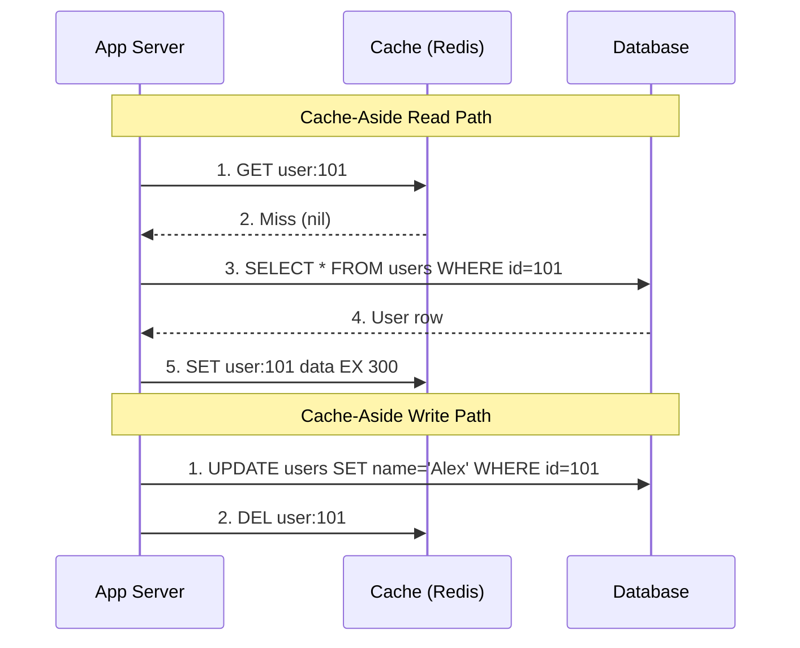
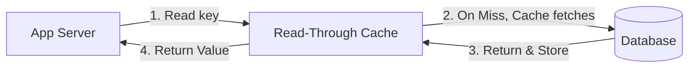
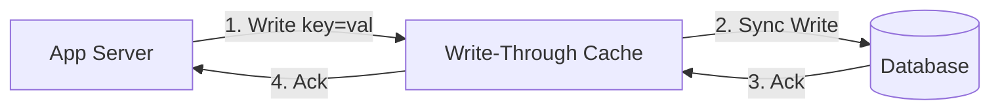
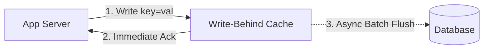
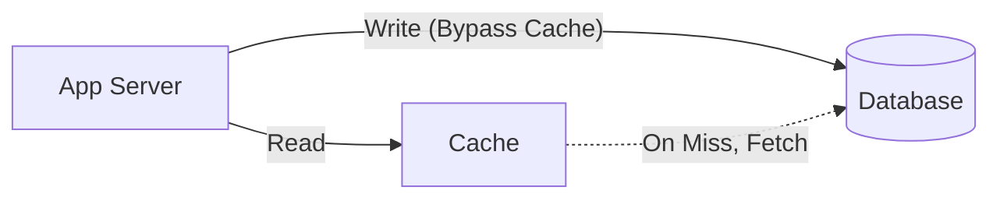
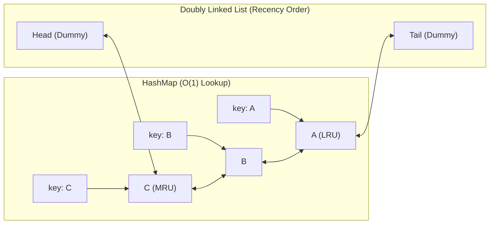
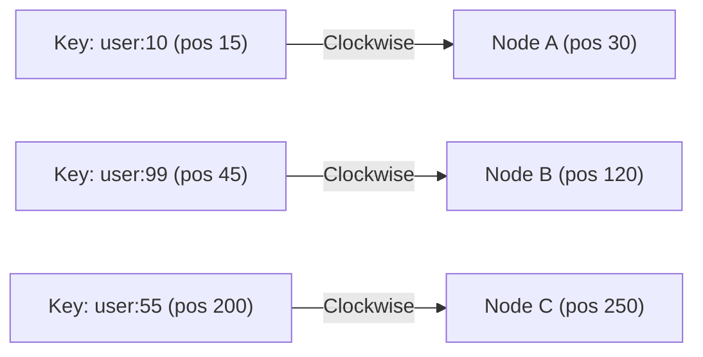

# Caching Deep Dive: Patterns, Internals, and Distributed Scaling

This guide covers how caching works under the hood for both High-Level Design (HLD) and Low-Level Design (LLD) interviews: read/write patterns, eviction algorithms, `O(1)` data structures, distributed sharding, and production failure modes.

---

## Contents

- [Caching Patterns (Read and Write Strategies)](#caching-patterns-read-and-write-strategies)
  - [1. Cache-Aside (Lazy Loading)](#1-cache-aside-lazy-loading)
  - [2. Read-Through](#2-read-through)
  - [3. Write-Through](#3-write-through)
  - [4. Write-Behind (Write-Back)](#4-write-behind-write-back)
  - [5. Write-Around](#5-write-around)
  - [6. Refresh-Ahead](#6-refresh-ahead)
  - [Pattern Comparison](#pattern-comparison)
- [Eviction and Expiration Policies (LLD + Internals)](#eviction-and-expiration-policies-lld--internals)
  - [Common Eviction Policies](#common-eviction-policies)
  - [LLD: Designing an O(1) LRU Cache](#lld-designing-an-o1-lru-cache)
  - [LLD: Designing an O(1) LFU Cache](#lld-designing-an-o1-lfu-cache)
  - [Thread Safety in LLD](#thread-safety-in-lld)
  - [TTL Expiration: Passive vs Active](#ttl-expiration-passive-vs-active)
- [Distributed Caching and Scaling (HLD)](#distributed-caching-and-scaling-hld)
  - [Local Cache vs Distributed Cache](#local-cache-vs-distributed-cache)
  - [Redis vs Memcached](#redis-vs-memcached)
  - [Partitioning and Consistent Hashing](#partitioning-and-consistent-hashing)
  - [Replication and High Availability](#replication-and-high-availability)
- [Production Failure Modes and Consistency](#production-failure-modes-and-consistency)
  - [1. Cache Stampede (Thundering Herd)](#1-cache-stampede-thundering-herd)
  - [2. Cache Penetration](#2-cache-penetration)
  - [3. Cache Avalanche](#3-cache-avalanche)
  - [4. The Hot Key Problem](#4-the-hot-key-problem)
  - [5. Cache-DB Consistency and Race Conditions](#5-cache-db-consistency-and-race-conditions)
- [Summary](#summary)

---

## Caching Patterns (Read and Write Strategies)

Choosing a caching pattern comes down to two questions:
1. Who talks to the database: the **application** or the **cache**?
2. When data is written, do we update the cache **synchronously**, **asynchronously**, or **not at all**?

### 1. Cache-Aside (Lazy Loading)

The most common pattern in production (used with Redis and Memcached). The application owns both the cache and the database; the cache does not talk to the database at all.

- **On Read:** App checks the cache. On a hit, return immediately. On a miss, app queries the DB, writes the result into the cache with a TTL, and returns it.
- **On Write:** App writes to the DB and **deletes** (invalidates) the key from the cache so the next read fetches fresh data.

| Pros | Cons |
|------|------|
| Only requested data is cached (no wasted RAM) | First request for a key always suffers a cache miss |
| Resilient to cache failure (app falls back to DB) | Possible stale data window between DB update and cache delete |
| Simple to implement with Redis / Memcached | App code must manage cache + DB coordination |

> **Why delete on write instead of update on write?** If two concurrent writes happen (`W1` then `W2`), `W2` might finish updating the DB after `W1`, but `W1` could overwrite the cache last, leaving stale data. Deleting is idempotent and safer.

---

### 2. Read-Through

The cache sits inline between the application and the database. The application only talks to the cache. On a cache miss, the **cache provider itself** (via a configured loader plugin) queries the database, stores the entry, and returns it.

- **Real-world examples:** Amazon DynamoDB Accelerator (DAX), Caffeine `LoadingCache`, Hazelcast.
- **Best for:** Read-heavy workloads where you want clean application code without `if (cache.get() == null)` boilerplate everywhere.

---

### 3. Write-Through

The application writes data directly to the cache. The **cache synchronously writes to the database** before acknowledging success to the application.

| Pros | Cons |
|------|------|
| Cache and DB are always consistent | Higher write latency (must wait for both cache + DB) |
| Newly written data is immediately warm in cache | Unused data may fill up cache RAM unless paired with eviction |
| Low risk of data loss compared to Write-Behind | Requires a cache system that supports DB connectors |

- **Best for:** Systems that need strong consistency and read-after-write guarantees (user profiles, configuration stores, financial metadata). Often paired with **Read-Through**.

---

### 4. Write-Behind (Write-Back)

The application writes to the cache and receives an **immediate acknowledgment**. The cache then **asynchronously** flushes/batches writes to the database in the background.

| Pros | Cons |
|------|------|
| Ultra-fast write latency (RAM speed) | **Risk of data loss** if cache node crashes before flushing to DB |
| Coalesces multiple writes to the same key into 1 DB write | Complex recovery, retry, and ordering logic |
| Absorbs massive write spikes without overwhelming DB | DB is eventually consistent |

- **Real-world examples:** View counters on YouTube, like counts on Instagram, gaming telemetry, OS page cache dirty pages.

---

### 5. Write-Around

Writes go **directly to the database**, completely bypassing the cache. Only data that is later read gets loaded into the cache (usually paired with Cache-Aside or Read-Through).

- **Best for:** Write-heavy data that is rarely read immediately (e.g., logging, archive records, bulk imports). Prevents newly written data from flooding the cache and evicting hot keys.

---

### 6. Refresh-Ahead

The cache proactively refreshes a cached entry **asynchronously before its TTL expires**, if it detects the key is being accessed frequently.

- **Example:** Suppose TTL is `60s` and the refresh-ahead factor is `0.8` (`48s`). If a request arrives at `50s`, the cache immediately returns the current value (0 ms extra latency for the user) and triggers a background refresh from the DB.
- **Best for:** Predictable hot keys where even a single cache miss latency spike is unacceptable (e.g., homepages, exchange rates).

---

### Pattern Comparison

| Pattern | Read Latency | Write Latency | Consistency | Data Loss Risk | Best For |
|---------|--------------|---------------|-------------|----------------|----------|
| **Cache-Aside** | Fast on hit; slow on miss | Fast (DB + delete) | Eventual | None (DB is source of truth) | General-purpose read-heavy apps (Redis) |
| **Read-Through** | Fast on hit; slow on miss | N/A (pair with Write) | Eventual | None | Clean app abstraction (DAX, Caffeine) |
| **Write-Through** | Fast (always warm) | Slower (Cache + DB sync) | Strong | None | Read-after-write consistency |
| **Write-Behind** | Fast | Ultra-fast (RAM only) | Eventual | **High** (if cache crashes) | High-write counters, analytics, telemetry |
| **Write-Around** | Slow on first read | Fast (DB only) | Eventual | None | Bulk writes, logs, rarely read writes |
| **Refresh-Ahead** | Consistently fast | N/A | Eventual (bounded) | None | Ultra-hot keys with strict p99 latency |

---

## Eviction and Expiration Policies (LLD + Internals)

RAM is finite and expensive. When a cache reaches `maxmemory`, it must decide which key to **evict** to make room for new data.

### Common Eviction Policies

| Policy | How It Works | Pros / Cons |
|--------|--------------|-------------|
| **LRU (Least Recently Used)** | Evicts the item that hasn't been accessed for the longest time. | Great for temporal locality; vulnerable to one-time full scans polluting the cache. |
| **LFU (Least Frequently Used)** | Evicts the item with the lowest access count. | Great for long-term popular items; old viral items can linger forever unless counts decay over time. |
| **FIFO (First-In, First-Out)** | Evicts the oldest inserted item, regardless of reads. | Very simple queue; ignores popularity completely. |
| **Random** | Picks a random key to evict. | `O(1)` with zero metadata overhead; decent baseline when access is uniform. |
| **W-TinyLFU** | Combines a small admission window (LRU) with a frequency sketch (Count-Min Sketch) + segmented LRU. | Near-optimal hit ratio; scan-resistant. Used by **Caffeine** (Java). |

> **Redis Note:** Redis doesn't maintain a true global Doubly Linked List for LRU (too much memory overhead). Instead, Redis uses **approximated LRU/LFU**: it samples a small pool of random keys (default `maxmemory-samples 5`) and evicts the best candidate among them.

---

### LLD: Designing an O(1) LRU Cache

This is one of the most frequently asked LLD / Machine Coding questions. Both `get(key)` and `put(key, value)` must run in **`O(1)`** time.

**Why two data structures?**
- A **Hash Map** gives `O(1)` lookup by key, but has no concept of access order.
- A **Doubly Linked List (DLL)** gives `O(1)` node removal and insertion at the head/tail, but `O(n)` search.
- Combining **HashMap<Key, Node>** + **Doubly Linked List** gives `O(1)` for everything:

**Operations:**
1. **`get(key)`:**
   - Look up `node` in HashMap. If missing, return `-1` / `null`.
   - Detach `node` from its current position in the DLL and move it right after `Head` (Most Recently Used).
   - Return `node.value`.
2. **`put(key, value)`:**
   - If `key` exists: update `node.value` and move `node` to `Head`.
   - If `key` is new:
     - If `map.size() == capacity`: remove `Tail.prev` (Least Recently Used) from DLL and delete its key from HashMap.
     - Create new `node`, insert right after `Head`, and store in HashMap.

> Using **dummy `Head` and `Tail` sentinel nodes** eliminates null-pointer edge cases when the list is empty or has 1 element.

---

### LLD: Designing an O(1) LFU Cache

LFU requires evicting the key with the **minimum access frequency**. If there is a tie in frequency, evict the **Least Recently Used** among them.

**Data Structures for `O(1)` LFU:**
1. `keyToNode`: `HashMap<Key, Node>` (each `Node` stores `key`, `value`, and `freq`).
2. `freqToList`: `HashMap<Integer, DoublyLinkedList>` (maps a frequency count to a DLL of nodes with that frequency).
3. `minFreq`: an integer tracking the smallest non-empty frequency bucket.

**Operations:**
- On `get(key)` or `put(key)` update:
  1. Remove `node` from `freqToList[node.freq]`.
  2. If that list becomes empty AND `node.freq == minFreq`, increment `minFreq++`.
  3. Increment `node.freq++` and add `node` to the front of `freqToList[node.freq]`.
- On eviction (`size == capacity`):
  1. Evict the tail node from `freqToList[minFreq]` (the LRU node among the least frequent).
  2. On inserting a brand-new key, reset `minFreq = 1`.

---

### Thread Safety in LLD

In multi-threaded backends (Java, Go, C++), a naive HashMap + DLL will corrupt pointers under concurrent `get`/`put` calls. Common approaches in LLD rounds:

1. **Coarse-Grained Locking (`synchronized` / `Mutex`):** Simple and safe, but every `get()` blocks other `get()`s (because `get()` mutates the DLL!).
2. **Read-Write Lock (`ReentrantReadWriteLock`):** Helps only if reads don't mutate order (e.g., TTL-only). Doesn't help LRU because reads update recency.
3. **Striped Locking / Sharded Cache:** Partition the cache into `N` independent segments (e.g., 16 or 64 shards by `hash(key) % N`), each with its own lock and LRU list. Reduces lock contention by `N`x.
4. **Lock-Free / Ring Buffer (Caffeine style):** Buffer read events in a lossy ring buffer and apply recency updates asynchronously in batches.

---

### TTL Expiration: Passive vs Active

How does a cache like Redis actually remove expired keys?

1. **Passive (Lazy) Expiration:**
   When a client requests a key, the cache checks `now > key.expiresAt`. If expired, delete it and return a miss.
   - *Limitation:* Expired keys that are never requested again would sit in RAM forever.
2. **Active Expiration:**
   A background thread periodically samples a random batch of keys with TTLs (e.g., Redis checks 20 keys every 100 ms), deletes expired ones, and repeats if more than 25% of the sample was expired.

---

## Distributed Caching and Scaling (HLD)

A single cache server eventually hits RAM, CPU, or network bandwidth limits. At scale, we move to a **distributed cache cluster**.

### Local Cache vs Distributed Cache

| Dimension | Local / In-Process Cache (L1) | Distributed Cache (L2) |
|-----------|-------------------------------|------------------------|
| **Where it lives** | Inside each app server's JVM/process RAM | Separate dedicated cluster (Redis/Memcached) |
| **Latency** | ~100 ns (no serialization, no network) | ~0.5 to 2 ms (network + serialization) |
| **Consistency across pods** | Hard (each app pod has its own copy) | Easy (single shared source of truth) |
| **Capacity** | Limited by app server RAM | Scales horizontally to TBs across nodes |
| **Restart impact** | Lost whenever app deploys/restarts | Survives app deployments |

---

### Redis vs Memcached

Interviewers frequently ask: *"Would you choose Redis or Memcached here, and why?"*

| Feature | Redis | Memcached |
|---------|-------|-----------|
| **Data Structures** | Rich: Strings, Hashes, Lists, Sets, Sorted Sets (`ZSET`), Bitmaps, HyperLogLog, Streams | Simple: Key-Value strings/bytes only |
| **Threading Model** | Single-threaded command execution (event loop; I/O threads in Redis 6+) | Multi-threaded (scales well across many CPU cores for simple K/V) |
| **Persistence** | Yes: RDB snapshots + AOF (Append-Only File) | No (purely volatile in-memory) |
| **Replication & Sharding** | Built-in Primary-Replica, Sentinel, Redis Cluster | Client-side consistent hashing (no built-in clustering) |
| **Max Value Size** | Up to 512 MB | Default 1 MB per slab item |
| **Extra Capabilities** | Lua scripting, Pub/Sub, Distributed Locks, Rate Limiting, Leaderboards | Pure high-throughput object caching |

**Rule of thumb:** Default to **Redis** unless you specifically need a dead-simple, multi-threaded, volatile key-value store for large static HTML/object blobs where Memcached's multi-core scaling shines.

---

### Partitioning and Consistent Hashing

Suppose you have 3 cache nodes (`Node 0`, `Node 1`, `Node 2`). How do you decide which node stores `user:42`?

**Why Modulo Hashing (`hash(key) % N`) Fails:**
If `N = 3` changes to `N = 4` (adding a node) or `N = 2` (a node crashes), `hash(key) % N` changes for **almost every key** (~75% to 80% cache misses all at once), causing a massive database spike.

**Consistent Hashing (The Solution):**
1. Arrange both **cache nodes** and **keys** on a virtual hash ring from `0` to `2^32 - 1`.
2. Each key is routed **clockwise** to the first node on the ring.
3. When a node is added or removed, only `1 / N` of the keys need to move (just the keys owned by that slice), leaving the rest of the cluster intact.

**Virtual Nodes (vNodes):**
With only 3 physical nodes, one node could randomly get 70% of the ring (data skew). By assigning each physical node **100 to 200 virtual positions** around the ring, keys distribute evenly and a crashed node's load spreads across all remaining nodes rather than overloading a single neighbor.

*(Note: Redis Cluster uses a fixed **16,384 hash slots** via `CRC16(key) % 16384`, assigning slot ranges to each shard. Moving a slot between shards only migrates keys in that slot.)*

---

### Replication and High Availability

Sharding splits data for **capacity**; replication duplicates data for **availability and read scaling**.

1. **Primary-Replica Replication:** Every shard has 1 Primary (handles writes) and 1+ Replicas (asynchronously synced, can serve read traffic).
2. **Automatic Failover (Redis Sentinel / Redis Cluster):** Sentinel nodes monitor the Primary via heartbeats. If the Primary fails, a quorum of Sentinels promotes a Replica to Primary.
3. **Caveat:** Because Redis replication is asynchronous by default, a sudden Primary crash can lose writes that hadn't been replicated yet.

---

## Production Failure Modes and Consistency

These 5 scenarios are classic follow-up questions in senior system design interviews.

### 1. Cache Stampede (Thundering Herd)

**What happens:** A super-hot key (e.g., homepage config or celebrity post) expires. Before the cache is repopulated, 10,000 concurrent requests see a cache miss and **all 10,000 hit the database at the exact same time**, crashing the DB.

**Fixes:**
- **Request Coalescing / Singleflight (Mutex Lock):** Only the *first* thread on a miss acquires a lock (e.g., `SETNX` or Go's `singleflight`), queries the DB, and populates the cache. All other 9,999 threads wait for that single result.
- **Logical Expiration / Probabilistic Early Expiration:** Store a logical expiry inside the value and refresh asynchronously in the background slightly before the real TTL expires (Refresh-Ahead).

---

### 2. Cache Penetration

**What happens:** Requests arrive for keys that **do not exist in either the cache or the database** (e.g., `GET /user/-999` from a buggy client or malicious attacker). Every request misses the cache and hits the DB.

**Fixes:**
- **Cache Null / Empty Values:** Store `key -> NULL_MARKER` with a short TTL (e.g., 30 to 60 seconds) so repeated bogus lookups are absorbed by the cache.
- **Bloom Filter:** Put a space-efficient probabilistic **Bloom Filter** in front of the cache. If the Bloom Filter says *"this key definitely does not exist"*, reject the request immediately in `O(1)` without touching the cache or DB.

---

### 3. Cache Avalanche

**What happens:** Thousands of keys were loaded at the same time (e.g., during a bulk warm-up) with the **exact same TTL** (e.g., `3600s`), or an entire cache cluster restarts. They all expire simultaneously, slamming the DB.

**Fixes:**
- **TTL Jitter:** Add a random offset to every TTL: `ttl = base_ttl + random(0, 300s)` so expirations spread out smoothly over time.
- **High Availability + Circuit Breakers:** Use Redis Cluster/Sentinel to prevent single-node outages, and rate-limit/shed load if DB CPU spikes.

---

### 4. The Hot Key Problem

**What happens:** One single key (e.g., Taylor Swift's new album or a viral flash-sale item) receives 500,000 QPS. Even with 10 Redis shards, Consistent Hashing routes **100% of that key's traffic to a single Redis shard**, melting its CPU/network NIC while the other 9 shards sit idle.

**Fixes:**
- **L1 Local In-Memory Cache:** Cache ultra-hot keys inside each app server's own RAM for a tiny TTL (e.g., 1 to 5 seconds) to absorb 99% of reads before hitting Redis.
- **Key Salting / Replication:** Append a random suffix (`hot_key#1` .. `hot_key#10`) so reads scatter across all 10 Redis shards (only works for read-heavy, mostly static hot keys).

---

### 5. Cache-DB Consistency and Race Conditions

Keeping a cache and a database 100% synchronized without distributed transactions is fundamentally hard.

**Classic Race Condition (Cache-Aside):**
1. Thread A reads `user:1` -> Cache Miss. Reads old value `V1` from DB.
2. Thread B updates `user:1` to `V2` in DB, and deletes `user:1` from cache.
3. Thread A (which was paused/slow) now writes stale `V1` into the cache! Now `V1` stays stale until TTL expires.

**Practical Solutions:**
- **Always Set a TTL:** Acts as a safety net so stale data never lives forever.
- **Delete on Write (not Update on Write):** Reduces overwrite races.
- **Delayed Double Delete:** Delete cache -> Update DB -> Sleep ~100-500ms -> Delete cache again (clears any in-flight stale write).
- **CDC (Change Data Capture) via Debezium + Kafka:** Instead of the app invalidating the cache, stream DB binlog/WAL changes via Kafka to a dedicated cache-updater service. Decouples invalidation and guarantees at-least-once sync even if an app server crashes right after a DB commit.

---

## Summary

| Concept | One-liner |
|---------|-----------|
| **Cache-Aside** | App checks cache, falls back to DB on miss, deletes key on write. Most common pattern. |
| **Write-Through vs Write-Behind** | Write-Through syncs to DB immediately (consistent, slower writes); Write-Behind batches async (fast writes, risk of data loss). |
| **O(1) LRU / LFU** | HashMap + Doubly Linked List (LRU); HashMap + Frequency-to-DLL map (LFU). |
| **Consistent Hashing** | Hash ring + virtual nodes minimize key remapping (`1/N`) when cache nodes scale up or down. |
| **Stampede / Penetration / Avalanche** | Stampede = hot key expires (fix: singleflight); Penetration = non-existent keys (fix: Bloom filter / cache null); Avalanche = mass expiry (fix: TTL jitter). |
| **Hot Key** | One key saturating one shard (fix: L1 local cache or key salting). |
| **Cache-DB Sync** | Always pair TTLs with delete-on-write, or use CDC (Debezium + Kafka) for reliable invalidation. |
