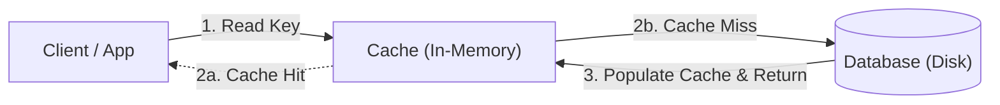

# Caching

Caching is a technique to store copies of frequently accessed data in a temporary, high-speed storage layer to reduce latency, offload downstream databases, and improve system throughput.

---

## Contents

- [The Problem: Why Caching?](#the-problem-why-caching)
- [How Caching Works](#how-caching-works)
- [Summary](#summary)

---

## The Problem: Why Caching?

Fetching data from disk or querying relational databases repeatedly introduces latency and consumes computing resources. A fast memory-based cache (e.g., Redis, Memcached) serves requests at sub-millisecond latencies.

## How Caching Works

---

## Summary

| Term | What it is |
|------|------------|
| **Cache Hit** | Requested data is found in cache storage. |
| **Cache Miss** | Requested data is not found in cache and must be fetched from persistent storage. |
