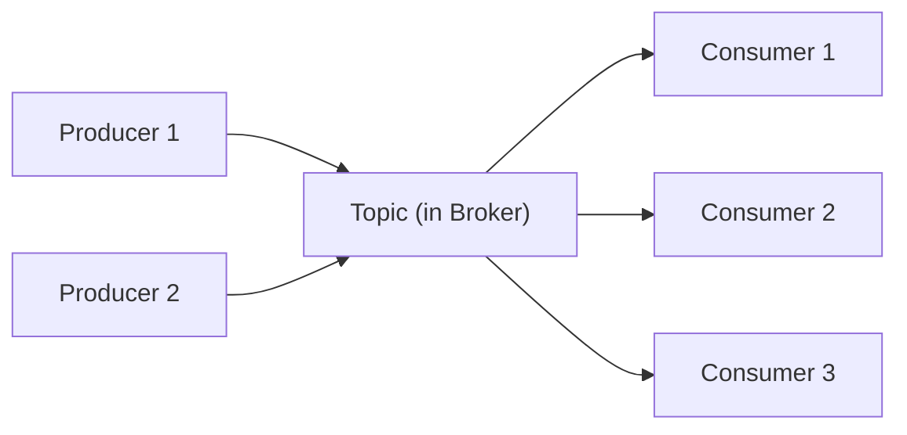
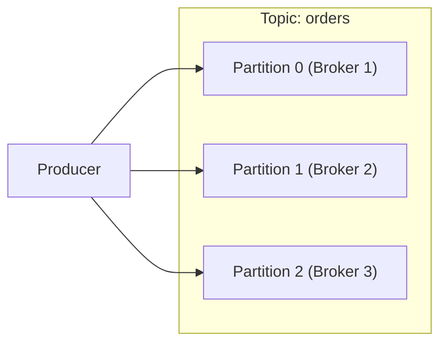
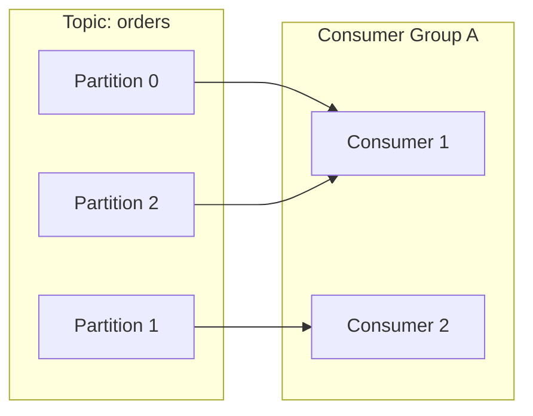
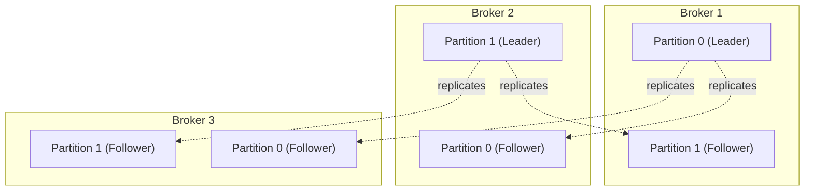

# Kafka

Apache Kafka is a distributed event streaming platform. It is designed to handle high-throughput, real-time data feeds reliably.

---

## Contents

- [Why Kafka?](#why-kafka)
  - [The Problem: Event-Heavy Applications](#the-problem-event-heavy-applications)
  - [Why Not Just Use APIs?](#why-not-just-use-apis)
  - [Real-World Scale](#real-world-scale)
- [How Kafka Works](#how-kafka-works)
  - [Core Concepts](#core-concepts)
  - [Decoupled Communication](#key-advantage-decoupled-communication)
  - [Offsets](#offsets)
  - [Why "Distributed"?](#why-distributed)
  - [Partitions](#partitions)
  - [Consumer Groups](#consumer-groups)
  - [Replication](#replication)
  - [Zookeeper and KRaft](#zookeeper-and-kraft)
- [Summary](#summary)

---

## Why Kafka?

### The Problem: Event-Heavy Applications

Consider a food delivery app like Uber Eats or Swiggy. A single order generates a chain of events:

```
User places order -> Order created -> Order placed -> Order accepted
-> Order being prepared -> Order dispatched -> Order delivered -> Order complete
```

Each of these events needs to reach multiple microservices: the restaurant service, delivery partner notifications, customer support, order tracking/telemetry, and more.

### Why Not Just Use APIs?

Direct API calls between services seem like the obvious approach, but they break down at scale:

1. **Combinatorial explosion of requests**
   If 10 events need to reach 10 microservices, that's 100 API calls per order. Scale that to thousands of concurrent orders and you're looking at hundreds of thousands of requests per minute.

2. **Retry overhead**
   When a downstream service rate-limits you (say, 5 req/min), the caller has to handle retries, backoffs, and queuing.

3. **Protocol differences**
   Different microservices might use different API protocols or data formats. The caller needs to know how to talk to each one.

4. **Service discovery**
   In dynamic environments like Kubernetes, IP addresses change constantly. Every caller needs to track DNS or service endpoints for every target.

5. **Security complexity**
   Each service may have its own TLS setup. To secure all inter-service communication, you'd need something like Istio with mTLS (mutual TLS), adding significant operational overhead.

### Real-World Scale

This isn't just a food delivery problem:

- **Stock brokerages** handle millions of market events per minute that need to fan out to analytics, risk engines, user dashboards, and more.
- **Streaming platforms like Netflix** generate thousands of user interaction events per second (plays, pauses, recommendations, buffering metrics).

Direct API-based communication simply doesn't work at this scale. You need a distributed event streaming platform.

---

## How Kafka Works

### Core Concepts



| Term | What it is |
|------|------------|
| **Broker** | A single Kafka server instance (similar to a node in a Kubernetes cluster). It stores and serves data. |
| **Topic** | A named category/feed to which messages are published. Think of it as a channel. Producers write to topics, consumers read from topics. |
| **Producer** | Publishes events/messages to a topic. |
| **Consumer** | Reads events/messages from a topic. Multiple independent consumers can read from the same topic at their own pace. |

### Key Advantage: Decoupled Communication

The producer publishes a message to a topic and moves on. It doesn't care who consumes it or when. This decoupling solves many of the API-based problems above.

**What if a consumer goes down?**

The producer is unaffected. No retries needed on the producer side. Once the consumer comes back up, it picks up right where it left off, thanks to **offsets**.

### Offsets

Every message in a topic has a sequential ID called an offset. A consumer tracks its own offset, so it knows exactly which messages it has already processed. It can even "go back in time" and re-read older messages if needed.

### Why "Distributed"?

A production Kafka setup runs as a **cluster** with multiple brokers, not just one.

```mermaid
flowchart TD
    subgraph Kafka Cluster
        B1["Broker 1"]
        B2["Broker 2"]
        B3["Broker 3"]
    end

    B1 --- B2
    B2 --- B3
    B1 --- B3

    P["Producers"] --> Kafka Cluster
    Kafka Cluster --> C["Consumers"]
```

Topics are spread across all brokers in the cluster through **partitions**. This gives Kafka:

- **Scalability**: Data is distributed across multiple machines.
- **Fault tolerance**: If one broker goes down, other brokers still have copies of the data (via replication).
- **High throughput**: Multiple brokers can serve reads and writes in parallel.

> A topic is a logical concept. Physically, it is split into partitions that live on different brokers.

### Partitions

A partition is the unit of parallelism in Kafka. When you create a topic, you choose how many partitions it should have.



**How messages are assigned to partitions:**

- If a message has a **key** (e.g., `order_id`), Kafka hashes the key and routes it to a specific partition. This guarantees that all messages with the same key land in the same partition and are processed in order.
- If there is **no key**, Kafka distributes messages across partitions in a round-robin fashion.

**Why this matters:**

- Each partition is an ordered, immutable log of messages.
- Ordering is guaranteed **within a partition**, but not across partitions.
- More partitions = more parallelism, since different consumers can read different partitions simultaneously.

### Consumer Groups

A consumer group is a set of consumers that work together to consume a topic. Kafka ensures that each partition is read by exactly one consumer in the group.



**Key rules:**

- One partition can only be assigned to one consumer within the same group.
- If you have more consumers than partitions, some consumers sit idle.
- If a consumer in the group crashes, Kafka **rebalances** and reassigns its partitions to the remaining consumers.
- Different consumer groups read the same topic independently. Group A and Group B each maintain their own offsets.

**Example:** The `orders` topic might be consumed by:
- Consumer Group A: the billing service (3 instances)
- Consumer Group B: the analytics service (2 instances)

Both groups get every message, but within each group, the work is split across members.

### Replication

Kafka replicates each partition across multiple brokers to handle failures.



| Term | What it is |
|------|------------|
| **Replication factor** | How many copies of each partition exist. A factor of 3 means 1 leader + 2 followers. |
| **Leader** | The broker that handles all reads and writes for a partition. |
| **Follower** | A broker that keeps a copy of the partition data. It syncs from the leader. |
| **ISR (In-Sync Replicas)** | The set of replicas that are fully caught up with the leader. If the leader goes down, one of the ISRs takes over. |

If a broker goes down, one of the in-sync followers is promoted to leader. Producers and consumers are redirected automatically. No data loss as long as the ISR set is healthy.

### Zookeeper and KRaft

Kafka needs something to manage cluster metadata: which brokers are alive, which broker is the leader for each partition, topic configurations, etc.

**Zookeeper (legacy approach)**
- Kafka originally relied on Apache Zookeeper, a separate distributed coordination service, to manage this metadata.
- This worked, but it meant running and maintaining an entirely separate cluster alongside Kafka.

**KRaft (modern approach, Kafka 3.3+)**
- KRaft (Kafka Raft) moves metadata management into Kafka itself.
- A few brokers in the cluster are designated as **controllers** that use the Raft consensus protocol to manage metadata.
- No external dependency. Simpler to deploy and operate.

> New Kafka deployments should use KRaft. Zookeeper support is being phased out.

---

## Summary

| Concept | One-liner |
|---------|-----------|
| **Broker** | A single Kafka server that stores and serves data. |
| **Topic** | A named channel that messages are published to. |
| **Partition** | A subset of a topic that lives on one broker. Unit of parallelism. |
| **Offset** | A sequential ID for each message in a partition. Consumers track their position using offsets. |
| **Producer** | Writes messages to topics. |
| **Consumer** | Reads messages from topics. |
| **Consumer Group** | A set of consumers that split the work of reading a topic. |
| **Replication** | Copies of partitions across brokers for fault tolerance. |
| **KRaft** | Built-in metadata management replacing Zookeeper. |
