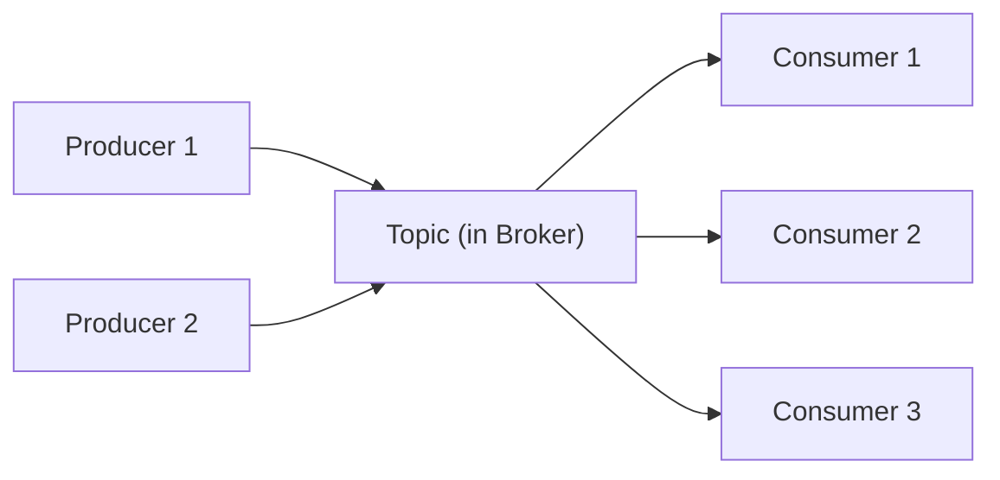
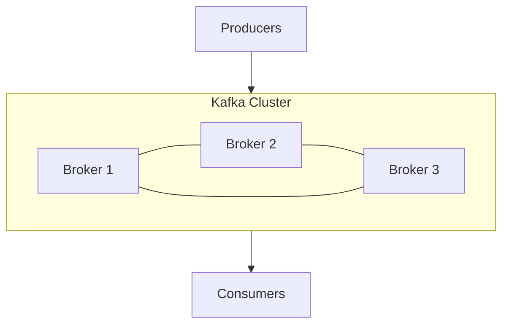
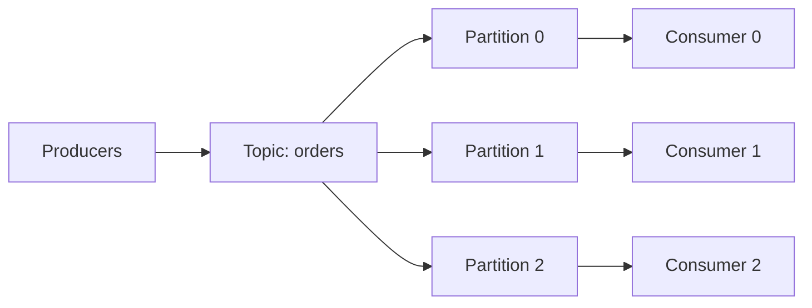

# Kafka

Apache Kafka is a distributed event streaming platform. It is designed to handle high-throughput, real-time data feeds reliably.

---

## Contents

- [Why Kafka?](#why-kafka)
  - [The Problem: Event-Heavy Applications](#the-problem-event-heavy-applications)
  - [Why Not Just Use APIs?](#why-not-just-use-apis)
  - [Real-World Scale](#real-world-scale)
- [How Kafka Works](#how-kafka-works)
  - [Core Concepts](#core-concepts)
  - [Decoupled Communication](#key-advantage-decoupled-communication)
  - [Offsets](#offsets)
  - [Why "Distributed"?](#why-distributed)
  - [Partitions and Consumer Groups](#partitions-and-consumer-groups)
- [Summary](#summary)

---

## Why Kafka?

### The Problem: Event-Heavy Applications

Consider a food delivery app like Uber Eats or Swiggy. A single order generates a chain of events:

```
User places order -> Order created -> Order placed -> Order accepted
-> Order being prepared -> Order dispatched -> Order delivered -> Order complete
```

Each of these events needs to reach multiple microservices: the restaurant service, delivery partner notifications, customer support, order tracking/telemetry, and more.

### Why Not Just Use APIs?

Direct API calls between services seem like the obvious approach, but they break down at scale:

1. **Combinatorial explosion of requests**
   If 10 events need to reach 10 microservices, that's 100 API calls per order. Scale that to thousands of concurrent orders and you're looking at hundreds of thousands of requests per minute.

2. **Retry overhead**
   When a downstream service rate-limits you (say, 5 req/min), the caller has to handle retries, backoffs, and queuing.

3. **Protocol differences**
   Different microservices might use different API protocols or data formats. The caller needs to know how to talk to each one.

4. **Service discovery**
   In dynamic environments like Kubernetes, IP addresses change constantly. Every caller needs to track DNS or service endpoints for every target.

5. **Security complexity**
   Each service may have its own TLS setup. To secure all inter-service communication, you'd need something like Istio with mTLS (mutual TLS), adding significant operational overhead.

### Real-World Scale

This isn't just a food delivery problem:

- **Stock brokerages** handle millions of market events per minute that need to fan out to analytics, risk engines, user dashboards, and more.
- **Streaming platforms like Netflix** generate thousands of user interaction events per second (plays, pauses, recommendations, buffering metrics).

Direct API-based communication simply doesn't work at this scale. You need a distributed event streaming platform.

---

## How Kafka Works

### Core Concepts



| Term | What it is |
|------|------------|
| **Broker** | A single Kafka server instance (similar to a node in a Kubernetes cluster). It stores and serves data. |
| **Topic** | A named category/feed to which messages are published. Think of it as a channel. Producers write to topics, consumers read from topics. |
| **Producer** | Publishes events/messages to a topic. |
| **Consumer** | Reads events/messages from a topic. Multiple independent consumers can read from the same topic at their own pace. |

### Key Advantage: Decoupled Communication

The producer publishes a message to a topic and moves on. It doesn't care who consumes it or when. This decoupling solves many of the API-based problems above.

**What if a consumer goes down?**

The producer is unaffected. No retries needed on the producer side. Once the consumer comes back up, it picks up right where it left off, thanks to **offsets**.

### Offsets

Every message in a topic has a sequential ID called an offset. A consumer tracks its own offset, so it knows exactly which messages it has already processed. It can even "go back in time" and re-read older messages if needed.

### Why "Distributed"?

A production Kafka setup runs as a **cluster** with multiple brokers, not just one.



Topics are spread across all brokers in the cluster through **partitions**. This gives Kafka:

- **Scalability**: Data is distributed across multiple machines.
- **Fault tolerance**: If one broker goes down, other brokers still have copies of the data (via replication).
- **High throughput**: Multiple brokers can serve reads and writes in parallel.

### Partitions and Consumer Groups

A topic is a logical stream, but Kafka stores it as a set of **partitions**. Each partition is an ordered, append-only log. This means a topic can scale horizontally by spreading different partitions across different brokers.

A producer can send messages to a specific partition, or Kafka can choose one based on a message key. If the same key is used, Kafka usually sends all messages for that key to the same partition, which preserves order for that key.



Now think about consumer groups. A consumer group is a set of consumers working together to process a topic. Kafka guarantees that each partition is assigned to only one consumer in the group at a time. That gives a useful pattern:

- If you start 10 pods in the same consumer group and the topic has 10 partitions, Kafka can distribute one partition to each pod.
- If you start 3 pods for a 10-partition topic, some pods will process multiple partitions.
- If you start a second consumer group, both groups can read the same topic independently, which is why Kafka is often used for both real-time processing and analytics.

Each partition has a **leader**. The leader handles reads and writes for that partition, while followers replicate the data for fault tolerance. This is how Kafka keeps a stream available even if one broker fails.

A few practical notes:

- Too many partitions can add operational complexity and overhead.
- The right number of brokers, topics, and partitions depends on throughput and latency requirements.
- For most teams, a managed Kafka service such as Aiven or Confluent is the simplest place to start.

---

## Summary

| Concept | One-liner |
|---------|------------|
| **Topic** | A named stream of events. |
| **Broker** | A Kafka server that stores and serves data. |
| **Partition** | A shard of a topic that allows parallelism and scale. |
| **Consumer group** | A set of consumers that share a topic by splitting partitions among themselves. |
| **Offset** | The position of a message inside a partition. |
| **Leader/Follower** | A partition leader serves reads and writes, while followers replicate data for resilience. |
