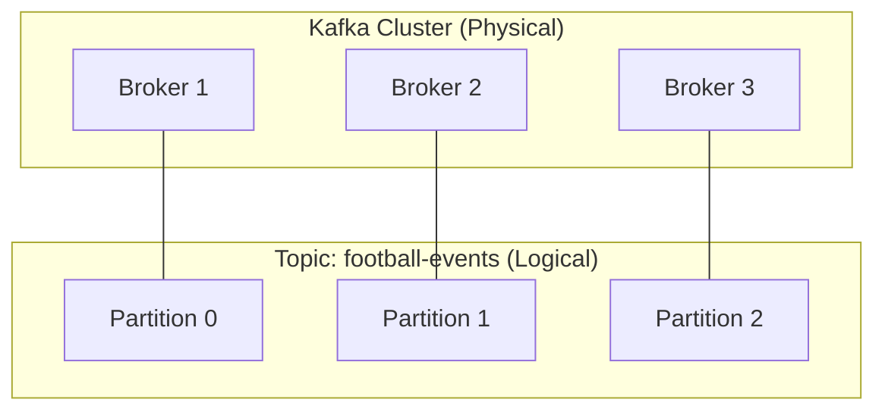
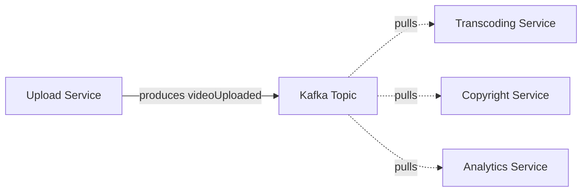
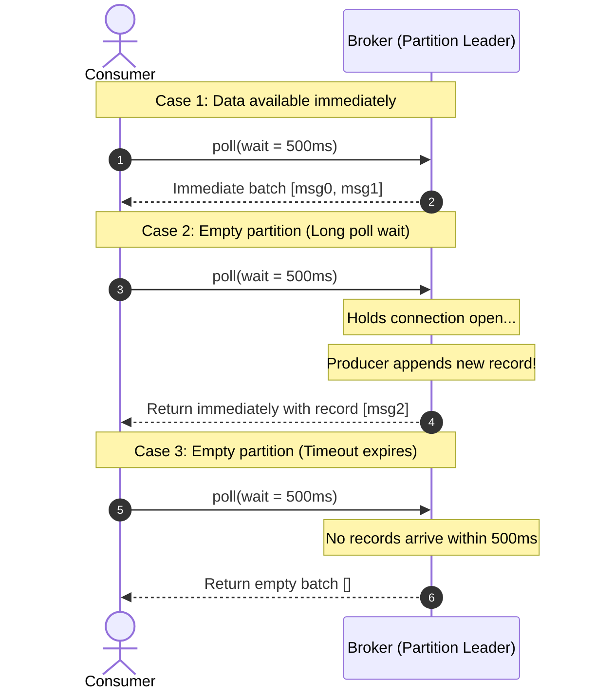
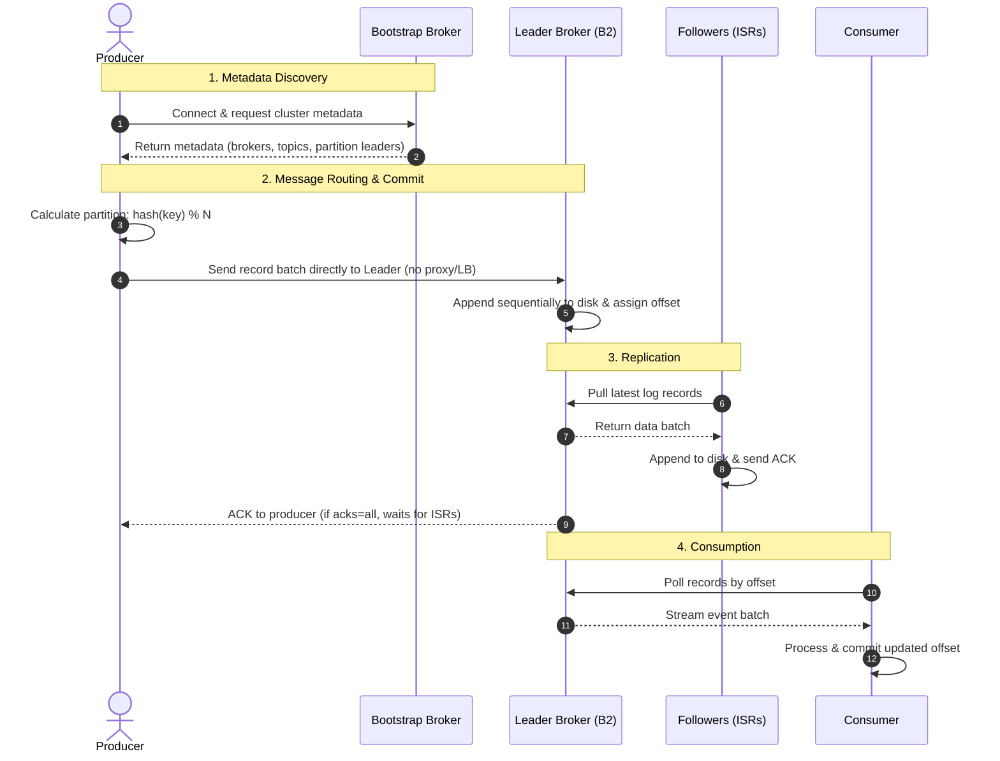

# Kafka Architecture & Internals

Kafka is a distributed, append-only commit log designed as a high-throughput, fault-tolerant event streaming platform.

---

## Contents

- [1. Core Building Blocks](#1-core-building-blocks)
  - [Topics & Events](#topics--events)
  - [Brokers & Clusters](#brokers--clusters)
- [2. Partitions & Physical Storage](#2-partitions--physical-storage)
  - [Logical Topics vs Physical Partitions](#logical-topics-vs-physical-partitions)
  - [Why Do We Need Partitions?](#why-do-we-need-partitions)
  - [Ordering Guarantees & Key Hashing](#ordering-guarantees--key-hashing)
  - [Creating a Topic](#creating-a-topic)
- [3. Consumers, Groups & Offsets](#3-consumers-groups--offsets)
  - [Consumer Groups & Partition Assignment](#consumer-groups--partition-assignment)
  - [Adding a Consumer to an Existing Group](#adding-a-consumer-to-an-existing-group)
  - [Offsets & `__consumer_offsets`](#offsets--__consumer_offsets)
  - [Pull Model & Long Polling](#pull-model--long-polling)
  - [What Happens During a Consumer Crash?](#what-happens-during-a-consumer-crash)
  - [Can Offsets Go Backwards? (Manual Seek)](#can-offsets-go-backwards-manual-seek)
- [4. High Availability & End-to-End Flow](#4-high-availability--end-to-end-flow)
  - [Partition Replication & Leader Election](#partition-replication--leader-election)
  - [Kafka Metadata & Controller](#kafka-metadata--controller)
  - [Complete End-to-End Flow](#complete-end-to-end-flow)
  - [Handling Corrupted or Invalid Events (DLQ)](#handling-corrupted-or-invalid-events-dlq)
- [5. Why Kafka Is Fast: Deep Storage Internals](#5-why-kafka-is-fast-deep-storage-internals)
  - [High-Throughput Writes](#high-throughput-writes)
  - [High-Throughput Reads & Zero-Copy](#high-throughput-reads--zero-copy)
- [6. System Design Decisions & Trade-offs](#6-system-design-decisions--trade-offs)
  - [How Many Partitions to Choose?](#how-many-partitions-to-choose)
  - [Increasing Partitions in Production](#increasing-partitions-in-production)
  - [Retention & Cleanup Policies](#retention--cleanup-policies)
  - [Offset Commit Strategies](#offset-commit-strategies)
  - [Delivery Guarantees (At-Most-Once vs At-Least-Once vs EOS)](#delivery-guarantees-at-most-once-vs-at-least-once-vs-eos)
  - [Backpressure Handling](#backpressure-handling)
  - [Kafka vs Traditional Pub-Sub vs RabbitMQ](#kafka-vs-traditional-pub-sub-vs-rabbitmq)

---

## 1. Core Building Blocks

### Topics & Events

Consider a **Sports Tracker System**: Kafka streams events across multiple sports (cricket, football, tennis, F1).

An application like Cricbuzz only cares about cricket events. This is where **topics** come in:
- **Topic**: A logical stream/namespace that groups related events together (`cricket-events`, `football-events`, `orders`).
- **Event**: An immutable fact that occurred in the system.

A single topic can contain different event types (e.g., `football-events` contains `GoalScored`, `MatchStarted`, `FoulCommitted`).

**Sample Event Payload:**
```json
{
    "matchID": "MANU_VS_CHE",
    "event": "GOAL",
    "player": "Rashford",
    "timestamp": "2024-11-09T00:04:29"
}
```

| Concept | What It Is | Role |
|---------|------------|------|
| **Topic** | Logical stream / category | Groups related events together |
| **Event** | Immutable fact / record | Contains payload, key, timestamp, and headers |

### Brokers & Clusters

- **Broker**: A single Kafka server instance that stores partition logs on disk and handles producer write and consumer read requests.
- **Kafka Cluster**: A group of cooperating brokers working together to distribute load, eliminate Single Points of Failure (SPOF), and manage data replication.
- Brokers treat message payloads as raw byte arrays. They do not parse JSON/Protobuf schemas or evaluate business logic, keeping broker CPU overhead minimal.

---

## 2. Partitions & Physical Storage

### Logical Topics vs Physical Partitions

A topic is purely a logical abstraction (like a folder name). The actual physical data is sharded across one or more **partitions** (like individual files inside that folder).

Think of checking luggage at an airport: instead of one massive, unmanageable trunk, the load is split into smaller, balanced bags.



- Each partition is an independent, **append-only sequential commit log** stored on disk.
- A topic can contain multiple partitions, but a partition belongs strictly to **one topic**.
- A single broker can host multiple partitions from both the same topic and completely different topics (just as one Olympic stadium hosts multiple athletic matches).

### Why Do We Need Partitions?

Without partitions, a topic would be limited to a single log file on a single broker machine:
1. **Scalability**: Data size would be capped by the disk capacity of a single server.
2. **Parallelism**: Only one consumer could read at a time, creating a severe throughput bottleneck.
3. **No Fault Tolerance**: The single broker would become a Single Point of Failure (SPOF).

With partitions:
- Partitions are spread across different brokers and independent physical storage drives.
- Multiple consumers within a consumer group can read different partitions concurrently.
- Partitions can be replicated across separate brokers for high availability.

### Ordering Guarantees & Key Hashing

- **Within a Partition**: Messages are appended sequentially. Ordering is **strictly guaranteed within a single partition**.
- **Across Partitions**: Kafka provides **no global ordering guarantee** across different partitions. Enforcing cross-partition ordering would require distributed coordination locks across brokers, destroying horizontal throughput.

**How Messages Map to Partitions:**
- **Key Present**: The producer hashes the message key:
  $$\text{partition} = \text{hash}(\text{key}) \pmod N$$
  *Guarantee*: All records sharing the same key (e.g., `orderId = 123` or `matchID = MANU_VS_CHE`) consistently land in the exact same partition in chronological order.
- **Key Absent**: Kafka uses round-robin or sticky batching to distribute records evenly across all available partitions.

### Creating a Topic

Topics are provisioned by developers, DevOps, or platform teams via CLI or Admin APIs:

```bash
kafka-topics.sh --create \
  --topic orders \
  --partitions 6 \
  --replication-factor 3
```

---

## 3. Consumers, Groups & Offsets

### Consumer Groups & Partition Assignment

A **Consumer Group** represents an independent logical application (e.g., `billing-service` or `analytics-service`). Consumers within a group cooperate to divide the topic's partitions among themselves.

```
Topic: orders (3 Partitions: P0, P1, P2)

Consumer Group 1 (1:1 Partition Mapping):
  Consumer C1 <-> Partition P0
  Consumer C2 <-> Partition P1
  Consumer C3 <-> Partition P2

Consumer Group 2 (Independent Downstream Application):
  Consumer C4 <-> Partition P0
  Consumer C5 <-> Partition P1
  Consumer C6 <-> Partition P2
```

**Key Partition Assignment Rules:**
1. **One Consumer Per Partition within a Group**: Two consumers in the *same* consumer group can never read from the same partition simultaneously. This prevents race conditions and duplicate processing.
2. **Multiple Consumer Groups Read Concurrently**: Consumers from *different* consumer groups (e.g., C1 and C4) read from the same partition independently at their own pace.
3. **When Partitions > Consumers**: Single consumers are assigned multiple partitions (e.g., if there are 6 partitions and 2 consumers, C1 handles P0–P2, C2 handles P3–P5).
4. **When Consumers > Partitions**: Excess consumers sit **idle** without partition assignments, serving as hot standbys ready for failover.
5. **Multi-Topic Subscription**: A single consumer can subscribe to multiple topics simultaneously (via an explicit list or regex pattern like `.*-events`).
6. **Consumer as Producer**: A consumer can process incoming events and produce transformed events to another topic (event-driven stream pipelines).

### Adding a Consumer to an Existing Group

To scale out processing, start a new consumer instance with the same `group.id`:

```java
Properties props = new Properties();
props.put(ConsumerConfig.BOOTSTRAP_SERVERS_CONFIG, "broker1:9092,broker2:9092");
props.put(ConsumerConfig.GROUP_ID_CONFIG, "payment-service"); // Existing group ID
props.put(ConsumerConfig.KEY_DESERIALIZER_CLASS_CONFIG, StringDeserializer.class.getName());
props.put(ConsumerConfig.VALUE_DESERIALIZER_CLASS_CONFIG, StringDeserializer.class.getName());

KafkaConsumer<String, String> consumer = new KafkaConsumer<>(props);
consumer.subscribe(Collections.singletonList("orders"));
```

- When the new consumer joins, Kafka triggers a **group rebalance**, reallocating a share of partitions to the new instance automatically.

### Offsets & `__consumer_offsets`

An **offset** is a monotonically increasing integer assigned to each record upon write that uniquely identifies its position within a partition.

```
Partition 0: [ msg0 | msg1 | msg2 | msg3 | msg4 | msg5 | msg6 | msg7 | ... ]
                                      ^                    ^
                                      |                    |
                         Billing Group offset: 3    Analytics Group offset: 6
```

- An offset acts as a **bookmark**: it tells Kafka, *"This consumer group has successfully processed all records before this position."*
- Every record has an offset, scoped strictly to its partition.
- Offsets are persisted inside Kafka itself in an internal, compacted topic named `__consumer_offsets`.

**Structure of `__consumer_offsets`:**
$$\text{Key: } (\text{groupId}, \text{topic}, \text{partition}) \longrightarrow \text{Value: } \text{committedOffset}$$

| Consumer Group ID | Topic | Partition | Committed Offset |
|-------------------|-------|-----------|------------------|
| `payment-service` | `orders` | `P0` | `100` |
| `payment-service` | `orders` | `P1` | `80` |
| `analytics-service` | `orders` | `P0` | `105` |
| `analytics-service` | `orders` | `P1` | `105` |

Storing offsets in Kafka provides high availability, fault tolerance, replication across brokers, and durability across consumer crashes.

### Pull Model & Long Polling

Kafka relies on a client-driven **pull model with long polling** rather than a server-push model:



**How Long Polling Operates:**
1. The consumer issues a poll call: `consumer.poll(Duration.ofMillis(500))`.
2. **Data available**: The broker immediately returns the waiting batch.
3. **No data available**: The broker holds the request open up to `fetch.max.wait.ms` (e.g., 500ms).
4. **Data arrives during wait**: The broker responds immediately upon record arrival.
5. **Timeout elapses without data**: The broker returns an empty response `[]`, and the consumer loops back.



**Benefits of Pull-based Long Polling:**
- **Prevents consumer starvation/overwhelm**: Slow consumers consume at their own sustainable rate without getting swamped.
- **Optimized batching**: Consumers configure `fetch.min.bytes` to accumulate larger batches over the wait window, maximizing I/O efficiency.

### What Happens During a Consumer Crash?

1. If a consumer crashes before committing its offset, Kafka detects the heartbeat timeout and initiates a consumer group rebalance.
2. The crashed consumer's partitions are reassigned to surviving group members.
3. The newly assigned consumer inspects `__consumer_offsets` and resumes reading from the **last committed offset**.
4. Uncommitted messages are processed again, resulting in **duplicate processing** under Kafka's default **at-least-once** model.
5. *Philosophy*: Kafka prioritizes duplicate processing over permanent data loss. Downstream consumers should implement **idempotent writes** (upserts, unique database constraints) or deduplication stores.

### Can Offsets Go Backwards? (Manual Seek)

- **Standard Processing**: No. Offsets are strictly append-only and monotonically increasing.
- **Manual Seek**: Consumer applications can explicitly reposition their read cursor:
  ```java
  consumer.seek(topicPartition, targetOffset);
  ```
- **Common Engineering Use Cases**: Replaying past events after deploying a bug fix, inspecting historical records during incident debugging, or backfilling a new database/cache.

---

## 4. High Availability & End-to-End Flow

### Partition Replication & Leader Election

Kafka replicates partition logs across multiple brokers to prevent data loss.

- **Partition Leader**: One broker designated to handle all client read and write requests for that partition.
- **Followers**: Replicas on other brokers that pull data from the leader to stay synchronized.
- **ISR (In-Sync Replicas)**: The set of follower replicas actively caught up with the leader.
- If the partition leader crashes, the controller elects a replacement leader exclusively from the healthy ISR set.

| Replication Factor | Recommended Use Case |
|--------------------|----------------------|
| **1** | Local dev / testing only |
| **2** | Non-critical internal systems |
| **3** | **Industry standard** (can tolerate 1 broker loss safely with balanced hardware cost) |
| **4+** | High-criticality financial systems |

### Kafka Metadata & Controller

The **Kafka Controller** (managed via KRaft consensus; historically ZooKeeper) maintains cluster topology and routing state:
- Registered brokers and live nodes.
- Partition placement, leader assignments, replica lists, and ISR sets.

**Topology Placement Goals:**
- Distribute partitions and replicas evenly across physical machines so no broker is overloaded.
- Ensure replicas of the same partition never share the same physical server.

```yaml
# Schema structure                       # Concrete topic example
Cluster:                                 orders-topic:
  brokers:                                 partition 0:
    brokerId -> host:port                    leader: broker 1
                                             replicas: [1, 2]
Topics:                                      ISR: [1, 2]
  topicName:
    partitions:                            partition 1:
      partitionId:                           leader: broker 2
        leader: brokerId                     replicas: [2, 3]
        replicas: [brokerId, ...]            ISR: [2, 3]
        ISR: [brokerId, ...]
```

### Complete End-to-End Flow



1. **Bootstrap & Metadata Discovery**: Producer connects to any bootstrap broker, fetches cluster metadata, and caches the routing table locally.
2. **Partition Selection**: Producer hashes the message key ($\text{hash}(\text{key}) \pmod N$) or uses round-robin to choose the target partition.
3. **Direct Leader Send**: Producer routes records directly to the partition leader broker without intermediary load balancers.
4. **Append & Replicate**: Leader appends the record to disk, assigns an offset, and followers pull the update. If `acks=all`, the leader responds to the producer only after all ISRs acknowledge.
5. **Consumer Polling**: Consumers fetch metadata, connect directly to the partition leader, pull records, and commit updated offsets.

### Handling Corrupted or Invalid Events (DLQ)

Kafka stores **events, not mutable state**. Events are immutable historical facts that cannot be updated or deleted in place.

If invalid data is published:
1. **Compensating Events**: Produce a new corrective event (e.g., an `OrderCancelled` or `PaymentRefunded` event).
2. **Upstream Producer Validation**: Validate schema and payloads prior to calling `producer.send()`.
3. **Dead Letter Queue (DLQ)**: If a consumer encounters poison pills or malformed records, it forwards the failed record to a dedicated DLQ topic for alerting, offline debugging, and replay, while allowing the main consumer thread to continue unimpeded.

---

## 5. Why Kafka Is Fast: Deep Storage Internals

Kafka handles millions of writes and reads per second through explicit systems-level optimizations:

### High-Throughput Writes

1. **Sequential Disk Writes (Append-Only Log)**:
   - Kafka eliminates random disk I/O head seek times by strictly appending to the end of partition files. Sequential disk writes on NVMe drives achieve speeds comparable to main memory.
2. **OS Page Cache Utilization**:
   - Rather than maintaining message objects in JVM heap memory (which causes severe Garbage Collection pause penalties), Kafka writes directly into the OS kernel page cache. The OS flushes dirty pages asynchronously to disk.
3. **End-to-End Batching**:
   - Producers group records into batches based on `batch.size` and `linger.ms`. This minimizes system calls, optimizes network packet frames, and allows end-to-end compression (gzip, Snappy, LZ4, zstd).
4. **Horizontal Sharding**:
   - Workload is partitioned across multiple brokers, operating systems, and disk drives in parallel.

### High-Throughput Reads & Zero-Copy

1. **Sequential Prefetching**: Consumers read monotonically increasing offsets, allowing the OS kernel to aggressively prefetch sequential data blocks into page cache ahead of time.
2. **Page Cache Reuse**: When consumers tail the log closely, data is served directly out of kernel RAM without touching physical disks.
3. **Zero-Copy Optimization (`sendfile` syscall)**:
   In traditional servers, sending file data over network sockets involves 4 context switches and 4 copy operations:

   $$\text{Disk} \xrightarrow{\text{DMA}} \text{OS Page Cache} \xrightarrow{\text{CPU}} \text{JVM User Memory} \xrightarrow{\text{CPU}} \text{Socket Buffer} \xrightarrow{\text{DMA}} \text{NIC Buffer}$$

   Kafka uses the Linux `sendfile()` system call to transfer bytes directly from kernel page cache to the network card buffer:

   ```mermaid
   flowchart LR
       Disk[Physical Disk] -->|DMA Copy| PageCache[Kernel Page Cache]
       PageCache -->|sendfile descriptor| NIC[NIC Network Buffer]
       NIC -->|Network Stream| Consumer[Consumer Network]
   ```

   - **Zero user-space memory copies**.
   - **Zero CPU cycles wasted** copying memory buffers.
   - Context switches reduced from 4 to 2.
4. **Read Once, Fan-Out to Many**: If 1,000 consumers read the same partition batch, the data is loaded into the kernel page cache once and streamed via zero-copy to all 1,000 sockets.

---

## 6. System Design Decisions & Trade-offs

### How Many Partitions to Choose?

Choosing partition count is an upfront design-time capacity calculation:
1. **Target Throughput**: If topic load is 10,000 events/sec and one consumer can process 1,000 events/sec, you need at least 10 partitions.
2. **Maximum Consumer Parallelism**: Partition count sets the maximum number of active consumers per consumer group.
3. **Broker Overhead**: Each partition requires open file descriptors and memory buffers; over-partitioning increases controller failover and rebalance latency.

| Scale | Partition Count | Typical Scenarios |
|-------|-----------------|-------------------|
| **Small** | 3 - 6 | Low throughput, internal jobs, dev/staging environments |
| **Medium** | 12 - 24 | Standard production workloads, microservice event streaming |
| **Large** | 50+ | High-throughput pipelines (clickstreams, telemetry, ad tech) |

### Increasing Partitions in Production

You can increase partitions using Kafka CLI tools, but with a critical caveat:
- **The Ordering Caveat**: Keyed routing depends on $\text{hash}(\text{key}) \pmod N$. When $N$ increases, newly published records with key `order_123` will hash to a different partition than historical records for that key.
- Strict key-level chronological ordering is broken across the boundary of partition expansion.
- *Contrast with broker failure*: When a broker or partition replica crashes, partition count $N$ does not change; Kafka simply elects an existing ISR replica, preserving key routing.

### Retention & Cleanup Policies

Kafka does not delete records upon consumption. Cleanup is determined by topic configuration:
1. **Time-Based (`retention.ms` / `log.retention.hours`)**: Deletes log segments older than the configured threshold (default: 7 days).
2. **Size-Based (`retention.bytes` / `log.retention.bytes`)**: Discards oldest segments when partition disk usage exceeds a byte limit.
3. **Log Compaction (`cleanup.policy = compact`)**: Retains at least the last-known value for each message key, serving as an immutable changelog for state stores and caches.

### Offset Commit Strategies

| Strategy | Configuration | How It Works | Failure Risk & Verdict |
|----------|---------------|--------------|------------------------|
| **Auto Commit** | `enable.auto.commit = true` | Commits periodically in background (e.g., every 5s) | **High data loss risk**: Crashes before processing complete can skip unconsumed records permanently. Not recommended for critical production pipelines. |
| **Manual Synchronous** | `consumer.commitSync()` | Blocks consumer thread until broker confirms commit | Highly reliable; lower throughput due to blocking network round-trip. |
| **Manual Asynchronous** | `consumer.commitAsync()` | Non-blocking fire-and-forget commit | High throughput; requires callback error handling to prevent out-of-order offset commits. |

### Delivery Guarantees (At-Most-Once vs At-Least-Once vs EOS)

| Guarantee | How It Works | Trade-offs & Failure Behavior | Engineering Use Case |
|-----------|--------------|-------------------------------|----------------------|
| **At-most-once** | Commit offset **before** processing payload | If consumer crashes mid-processing, message is lost forever. **Zero duplicate risk, high data loss risk.** | Non-critical metrics, telemetry pings, live location tracking |
| **At-least-once** *(Default)* | Commit offset **after** successful processing | If consumer crashes before commit completes, records are re-read upon recovery. **Zero data loss risk, potential duplicates.** Downstream consumers must be **idempotent**. | Payment webhooks, order processing, inventory updates |
| **Exactly-once (EOS)** | Idempotent producer (`enable.idempotence=true`) + Transaction API (`read_committed`) | Transaction coordination across topics/partitions with state commits. Highest processing overhead. | Bank ledgers, financial balance calculations |

**Code Comparison:**

```java
// At-most-once (Commit before processing)
for (ConsumerRecord<String, String> record : records) {
    consumer.commitSync(); // 1. Commit offset first
    process(record);       // 2. Crash here -> message lost forever
}

// At-least-once (Commit after processing)
for (ConsumerRecord<String, String> record : records) {
    process(record);       // 1. Process business logic first
    consumer.commitSync(); // 2. Commit offset upon success (crash before commit -> replay)
}
```

### Backpressure Handling

**Backpressure** occurs when producers generate data faster than consumers can process it. In push-based message brokers, this causes memory buffer exhaustion, blocked threads, OOM crashes, or dropped messages.

**How Kafka Solves Backpressure Naturally:**
- **Client-Driven Pull Model**: Consumers poll only the volume of records they have resources to process (`max.poll.records`).
- **Autonomous Pacing**: If a downstream database slows down, consumers simply slow their polling frequency.
- **Durable Disk Buffer**: Unread messages accumulate safely on the broker's disk log up to the retention limit, giving consumers time to catch up without dropping data.

### Kafka vs Traditional Pub-Sub vs RabbitMQ

| Feature | Apache Kafka | Traditional Pub-Sub | RabbitMQ |
|---------|--------------|---------------------|----------|
| **Architecture** | Distributed append-only commit log | Message bus / topic exchanges | Broker with exchanges and queues |
| **Data Flow** | Pull-based (smart consumer) | Push-based | Push-based (smart broker) |
| **Message Replay** | Yes (rewind offsets at will) | No | No (deleted once acknowledged) |
| **Retention** | Time/size-based (persists post-read) | Ephemeral (until delivered) | Ephemeral (until ACKed) |
| **Throughput** | Millions of records/sec | Moderate | Tens of thousands/sec |
| **Scalability** | Native horizontal scaling via partitions | Dependent on provider | Vertical scaling; queue mirroring overhead |
| **Backpressure** | Natural (pull-based client control) | Difficult (broker pushes eagerly) | Complex (requires prefetch/flow control) |
| **Best For** | Event sourcing, analytics, stream processing | Simple push alerts, notifications | Complex AMQP routing, task worker queues |
