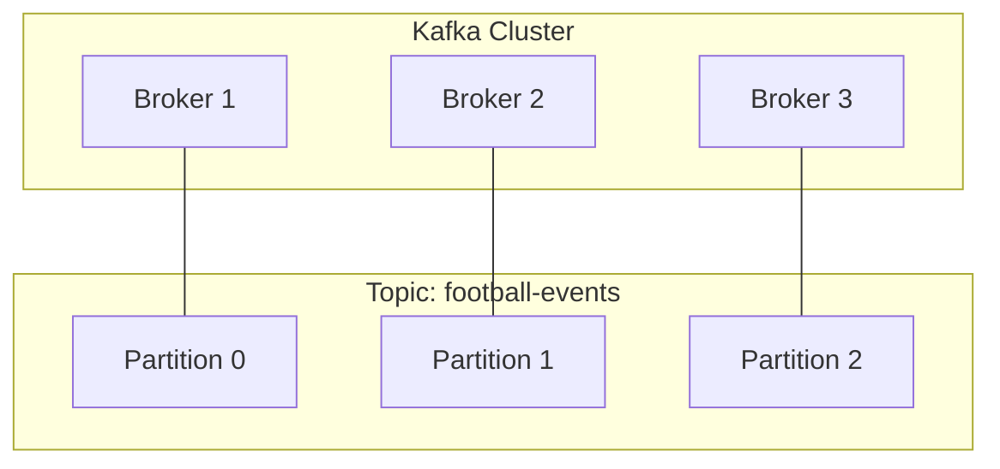
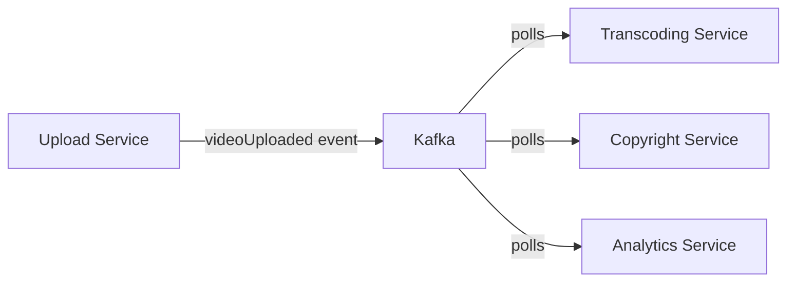

# Kafka

Kafka is a distributed log file that acts as a distributed event streaming platform.

---

## Contents

- [Topics](#topics)
- [Brokers and Clusters](#brokers-and-clusters)
- [Partitions](#partitions)
- [Ordering of Events](#ordering-of-events)
- [Consumer Groups](#consumer-groups)
- [Topic vs Event](#topic-vs-event)
- [Partitions: Deeper Look](#partitions-deeper-look)
- [Creating a Topic](#creating-a-topic)
- [How Events Are Consumed](#how-events-are-consumed)
- [Offsets](#offsets)
- [Where Are Offsets Stored?](#where-are-offsets-stored)
- [How Do Consumers Consume Events?](#how-do-consumers-consume-events)
- [What Is a Broker?](#what-is-a-broker)
- [What If Wrong Data Goes Into Kafka?](#what-if-wrong-data-goes-into-kafka)
- [Partition Replication](#partition-replication)

---

## Topics   

Consider a Sports Tracker System. Kafka keeps track of all events related to different sports: cricket, football, F1, and so on.

An app like Cricbuzz only cares about cricket events. This is where **topics** come in. A topic groups related events together.

Examples of topics:

```
football-events, cricket-events, tennis-events, f1-events
```

A single topic can contain different types of events. For example, the `football-events` topic might have:

- `GoalScored`
- `MatchStarted`
- `FoulCommitted`

**Sample event:**

```json
{
    "matchID": "MANU_VS_CHE",
    "event": "GOAL",
    "player": "Rashford",
    "timestamp": "2024-11-09T00:04:29"
}
```

Consumers like Cricbuzz or CricInfo subscribe to the topics they care about and read events from them.

## Brokers and Clusters

Where is the data actually stored? Data is physically stored in **brokers**, inside **partitions**.

Kafka runs multiple brokers to avoid a single point of failure (SPOF). A combination of these brokers/machines forms a **Kafka cluster**.

## Partitions

A topic is a logical division. The actual data lives in **partitions**, which are the physical storage units.

Think of it like a heavy bag at the airport being split into smaller luggage pieces. The topic is the logical grouping, the partitions are the physical split.



Key points:

- A broker can have multiple partitions and can hold events from different topics. Like the same Olympic stadium can host multiple different sports.
- Partitions can handle different subsets of data. For example, events related to Ind vs Pak can stay in P0, Aus vs NZ can stay in P1. There's no hard rule about which events go where.
- Kafka uses a **replication count** to copy partitions across brokers, avoiding SPOF if a partition goes down.

## Ordering of Events

Events within a single partition are ordered. You can control which partition an event goes to by using a key and hashing it.

For example: `matchId % N` determines the partition, and the partition itself maintains order.

**But what about ordering across partitions (P0, P1)?**

Partitions act independently. There is no ordering guarantee across partitions unless you explicitly synchronize them.

## Consumer Groups

A consumer group is a set of consumers that work together to read from a topic. Each consumer in the group reads from a different partition.

```
Consumer Group: CricInfo
  E1 <-> P0
  E2 <-> P1
  E3 <-> P2
```

Key rules:

- One partition can be consumed by consumers from **different** consumer groups. For example, both CricInfo and CricUpdates can consume from the same `runs` partition.
- But two consumers from the **same** consumer group cannot consume the same partition. This avoids duplicate processing.
- A consumer cannot exist without a consumer group.

## Topic vs Event

| | What it is |
|------|------------|
| **Topic** | A named stream/namespace that groups related events. |
| **Event** | A single fact that happened. |

## Partitions: Deeper Look

Each partition is:
- An ordered log
- Stored on disk
- Written sequentially

Ordering is guaranteed **within a partition**, not across partitions.

**Role of partitions:**
- Provide scalability
- Enable parallel processing
- Deliver high throughput

```
Topic: orders
|-- Partition 0
|-- Partition 1
|-- Partition 2
```

> A topic can contain multiple partitions, but a partition belongs to only one topic.

**Why do we need partitions if we already have the topic?**

A topic is not storage, it's just a logical name. Kafka needs physical storage to actually hold data.

Think of it this way:
- Topic = folder name
- Partition = actual files inside the folder

Without partitions, you'd have a single log file which isn't scalable, has no parallelism, and is a single point of failure.

With partitions:
- Each partition can exist on a different broker.
- Parallel consumers can read simultaneously (e.g., up to 5 consumers can read in parallel per consumer group).
- Partitions can be replicated across brokers for fault tolerance.

When you create a topic, you specify how many partitions it should have.

## Creating a Topic

A topic is created by an operator, developer, or platform team. Kafka does not create topics automatically.

```bash
kafka-topics.sh --create \
  --topic orders \
  --partitions 6 \
  --replication-factor 3
```

## How Events Are Consumed

Consider partitions P0, P1, P2 and two consumer groups:
- CG1 with consumer C0
- CG2 with consumers C1 and C2

Key rules:
- C1 and C2 (consumers from the same consumer group) cannot both consume from the same partition in parallel. They consume different partitions.
- C0 (from CG1) and C2 (from CG2) can consume from P1 in parallel, since they belong to different consumer groups. This is the power of event streaming: many consumers reading the same data independently.

## Offsets

An offset is a monotonically increasing number that uniquely identifies an event/record within a partition.

```
Partition 0: [ msg0 | msg1 | msg2 | msg3 | msg4 | msg5 | msg6 | ... ]
                                      ^                    ^
                                      |                    |
                                CG1 offset: 3        CG2 offset: 6
```

Each consumer group has its own offset **per partition**, so they operate independently.

- CG1 has offset 3: it will consume events from position 3 onwards.
- CG2 has offset 6: it will consume events from position 6 onwards.

An offset is like a bookmark. It says: "I have processed all messages before this point."

## Where Are Offsets Stored?

Offsets are stored in Kafka itself, in an internal topic called `__consumer_offsets`.

Why is this smart?
- Kafka is durable, so offsets are safe.
- Offsets are replicated across brokers.
- They survive consumer crashes.
- It's the responsibility of the consumer group to commit the offset.

## How Do Consumers Consume Events?

Kafka uses a **polling-based model**, not a push model. If Kafka pushed events to all consumers, it wouldn't be scalable and you'd lose independent consumption (unlike the observer pattern).

Instead, each consumer polls Kafka using its offset.



## What Is a Broker?

A broker is a Kafka server that stores data and serves read/write requests. It stores partitions on disk.

- A combination of brokers forms a cluster.
- Data is written as an **append-only log** (writes happen only at the end).
- No update or delete operations. You can only append at the end.

## What If Wrong Data Goes Into Kafka?

Kafka stores **events, not state**. It's not a database, it's a distributed log.

If a wrong event is added:

1. **Treat events as immutable facts.** Don't try to edit them. Instead, add a new compensating event.
2. **Validate before producing.** Catch bad data before it enters Kafka.
3. **Dead letter queue (DLQ).** If a consumer cannot process a message, it goes to a DLQ which stores:
   - Malformed data
   - Unexpected values
   - Poison messages

   Later, you can inspect, fix logic, or replay if needed.

Events are automatically deleted after the retention period.

---

**A few more things:**

- A consumer can subscribe to multiple topics.
- This removes tight coupling and reduces the responsibility of microservices interacting with each other. They communicate through Kafka events instead.
- A consumer can also be a producer for other events.

## Partition Replication

Helps avoid single points of failure (SPOF).