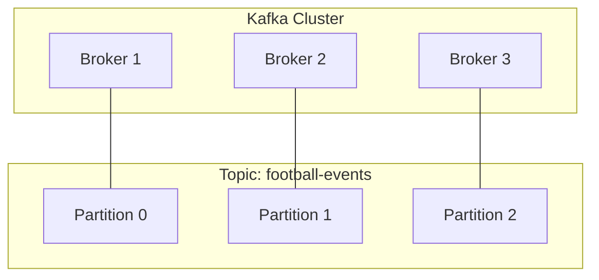
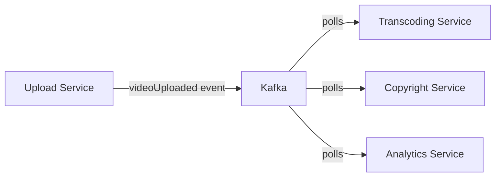
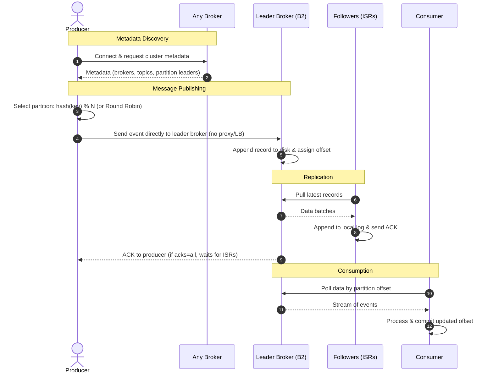
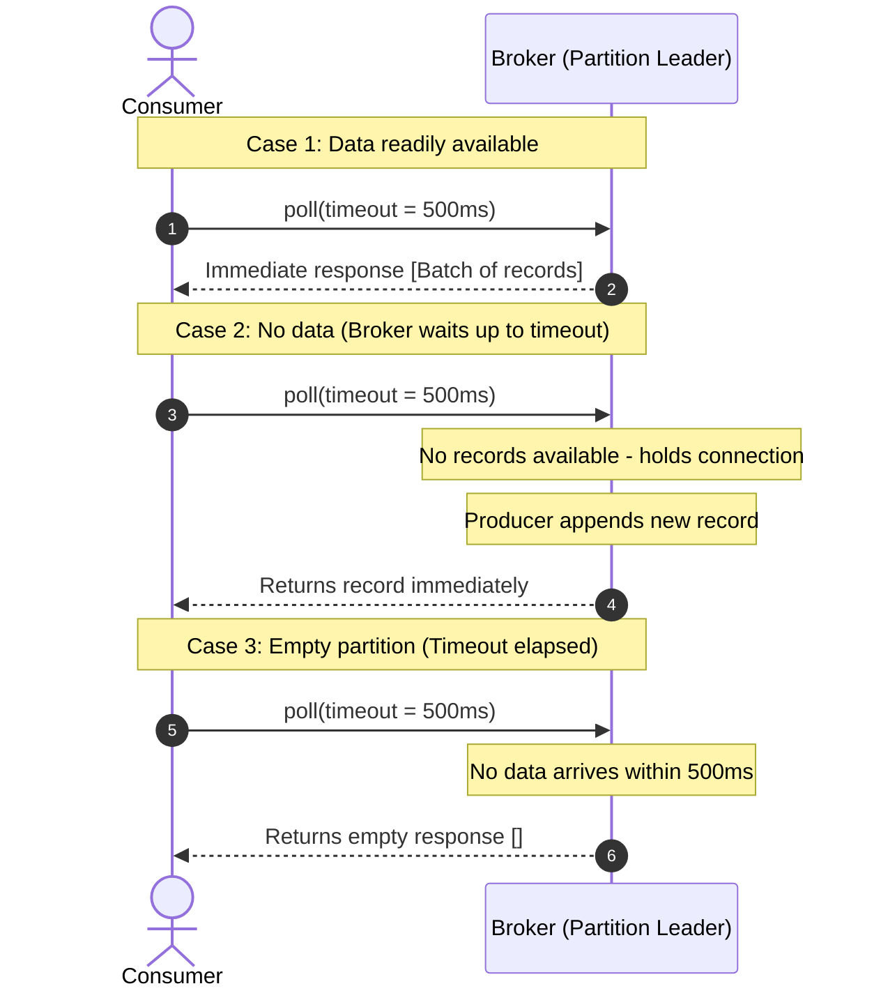
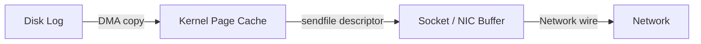

# Kafka

Kafka is a distributed log file that acts as a distributed event streaming platform.

---

## Contents

- [Topics](#topics)
- [Brokers and Clusters](#brokers-and-clusters)
- [Partitions](#partitions)
- [Ordering of Events](#ordering-of-events)
- [Consumer Groups](#consumer-groups)
- [Topic vs Event](#topic-vs-event)
- [Partitions: Deeper Look](#partitions-deeper-look)
- [Creating a Topic](#creating-a-topic)
- [How Events Are Consumed](#how-events-are-consumed)
- [Offsets](#offsets)
- [Where Are Offsets Stored?](#where-are-offsets-stored)
- [How Do Consumers Consume Events?](#how-do-consumers-consume-events)
- [What Is a Broker?](#what-is-a-broker)
- [What If Wrong Data Goes Into Kafka?](#what-if-wrong-data-goes-into-kafka)
- [Partition Replication](#partition-replication)
- [Kafka Metadata](#kafka-metadata)
- [Complete End-to-End Flow](#complete-end-to-end-flow)
- [Why Ordering Is Guaranteed Only Within a Partition](#why-is-ordering-guaranteed-only-within-a-partition)
- [Consumer Partition Assignment](#consumer-partition-assignment)
- [How Many Partitions Should We Choose?](#how-many-partitions-should-we-choose)
- [Can We Increase Partitions Later?](#can-we-increase-partitions-later)
- [When Are Events Deleted from Kafka?](#when-are-events-deleted-from-kafka)
- [Offset Commit Strategies](#offset-commit-strategies)
- [Delivery Guarantees](#delivery-guarantees)
- [How Does a Consumer Know an Event Has Arrived? (Long Polling)](#how-does-a-consumer-know-an-event-has-arrived-long-polling)
- [What Happens During a Consumer Crash?](#what-happens-during-a-consumer-crash)
- [Can Offsets Go Backwards?](#can-offsets-go-backwards)
- [Does Every Event Have an Offset? Who Assigns It?](#does-every-event-have-an-offset-who-assigns-it)
- [What Exactly Is Stored in `__consumer_offsets`?](#what-exactly-is-stored-in-__consumer_offsets)
- [Backpressure Handling](#backpressure-handling)
- [What Happens Internally When a Topic Is Created?](#what-happens-internally-when-a-topic-is-created)
- [How to Add a Consumer to an Existing Group?](#how-to-add-a-consumer-to-an-existing-group)
- [How Does Kafka Handle Massive Numbers of Writes?](#how-does-kafka-handle-massive-numbers-of-writes)
- [How Does Kafka Handle Massive Numbers of Reads?](#how-does-kafka-handle-massive-numbers-of-reads)
- [Pub-Sub vs Kafka](#pub-sub-vs-kafka)
- [When to Use Kafka vs Pub-Sub](#when-to-use-kafka-vs-pub-sub)
- [Kafka vs RabbitMQ](#kafka-vs-rabbitmq)
- [Is Kafka a Message Queue or an Event Stream?](#is-kafka-a-message-queue-or-an-event-stream)
- [Can a Partition Contain Events from Multiple Topics?](#can-a-partition-contain-events-from-multiple-topics)
- [Do We Create New Partitions for Every New Topic?](#do-we-create-new-partitions-for-every-new-topic)
- [How Physical Data Looks on Disk](#how-physical-data-looks-on-disk)
- [Can a Consumer in a CG Consume from Multiple Topics?](#can-a-consumer-in-a-cg-consume-from-multiple-topics)
- [Can a Consumer in a CG Consume from Multiple Partitions of the Same Topic?](#can-a-consumer-in-a-cg-consume-from-multiple-partitions-of-the-same-topic)

---

## Topics   

Consider a Sports Tracker System. Kafka keeps track of all events related to different sports: cricket, football, F1, and so on.

An app like Cricbuzz only cares about cricket events. This is where **topics** come in. A topic groups related events together.

Examples of topics:

```
football-events, cricket-events, tennis-events, f1-events
```

A single topic can contain different types of events. For example, the `football-events` topic might have:

- `GoalScored`
- `MatchStarted`
- `FoulCommitted`

**Sample event:**

```json
{
    "matchID": "MANU_VS_CHE",
    "event": "GOAL",
    "player": "Rashford",
    "timestamp": "2024-11-09T00:04:29"
}
```

Consumers like Cricbuzz or CricInfo subscribe to the topics they care about and read events from them.

## Brokers and Clusters

Where is the data actually stored? Data is physically stored in **brokers**, inside **partitions**.

Kafka runs multiple brokers to avoid a single point of failure (SPOF). A combination of these brokers/machines forms a **Kafka cluster**.

## Partitions

A topic is a logical division. The actual data lives in **partitions**, which are the physical storage units.

Think of it like a heavy bag at the airport being split into smaller luggage pieces. The topic is the logical grouping, the partitions are the physical split.



Key points:

- A broker can have multiple partitions and can hold events from different topics. Like the same Olympic stadium can host multiple different sports.
- Partitions can handle different subsets of data. For example, events related to Ind vs Pak can stay in P0, Aus vs NZ can stay in P1. There's no hard rule about which events go where.
- Kafka uses a **replication count** to copy partitions across brokers, avoiding SPOF if a partition goes down.

## Ordering of Events

Events within a single partition are ordered. You can control which partition an event goes to by using a key and hashing it.

For example: `matchId % N` determines the partition, and the partition itself maintains order.

**But what about ordering across partitions (P0, P1)?**

Partitions act independently. There is no ordering guarantee across partitions unless you explicitly synchronize them.

## Consumer Groups

A consumer group is a set of consumers that work together to read from a topic. Each consumer in the group reads from a different partition.

```
Consumer Group: CricInfo
  E1 <-> P0
  E2 <-> P1
  E3 <-> P2
```

Key rules:

- One partition can be consumed by consumers from **different** consumer groups. For example, both CricInfo and CricUpdates can consume from the same `runs` partition.
- But two consumers from the **same** consumer group cannot consume the same partition. This avoids duplicate processing.
- A consumer cannot exist without a consumer group.

## Topic vs Event

| | What it is |
|------|------------|
| **Topic** | A named stream/namespace that groups related events. |
| **Event** | A single fact that happened. |

## Partitions: Deeper Look

Each partition is:
- An ordered log
- Stored on disk
- Written sequentially

Ordering is guaranteed **within a partition**, not across partitions.

**Role of partitions:**
- Provide scalability
- Enable parallel processing
- Deliver high throughput

```
Topic: orders
|-- Partition 0
|-- Partition 1
|-- Partition 2
```

> A topic can contain multiple partitions, but a partition belongs to only one topic.

**Why do we need partitions if we already have the topic?**

A topic is not storage, it's just a logical name. Kafka needs physical storage to actually hold data.

Think of it this way:
- Topic = folder name
- Partition = actual files inside the folder

Without partitions, you'd have a single log file which isn't scalable, has no parallelism, and is a single point of failure.

With partitions:
- Each partition can exist on a different broker.
- Parallel consumers can read simultaneously (e.g., up to 5 consumers can read in parallel per consumer group).
- Partitions can be replicated across brokers for fault tolerance.

When you create a topic, you specify how many partitions it should have.

## Creating a Topic

A topic is created by an operator, developer, or platform team. Kafka does not create topics automatically.

```bash
kafka-topics.sh --create \
  --topic orders \
  --partitions 6 \
  --replication-factor 3
```

## How Events Are Consumed

Consider partitions P0, P1, P2 and two consumer groups:
- CG1 with consumer C0
- CG2 with consumers C1 and C2

Key rules:
- C1 and C2 (consumers from the same consumer group) cannot both consume from the same partition in parallel. They consume different partitions.
- C0 (from CG1) and C2 (from CG2) can consume from P1 in parallel, since they belong to different consumer groups. This is the power of event streaming: many consumers reading the same data independently.

## Offsets

An offset is a monotonically increasing number that uniquely identifies an event/record within a partition.

```
Partition 0: [ msg0 | msg1 | msg2 | msg3 | msg4 | msg5 | msg6 | ... ]
                                      ^                    ^
                                      |                    |
                                CG1 offset: 3        CG2 offset: 6
```

Each consumer group has its own offset **per partition**, so they operate independently.

- CG1 has offset 3: it will consume events from position 3 onwards.
- CG2 has offset 6: it will consume events from position 6 onwards.

An offset is like a bookmark. It says: "I have processed all messages before this point."

## Where Are Offsets Stored?

Offsets are stored in Kafka itself, in an internal topic called `__consumer_offsets`.

Why is this smart?
- Kafka is durable, so offsets are safe.
- Offsets are replicated across brokers.
- They survive consumer crashes.
- It's the responsibility of the consumer group to commit the offset.

## How Do Consumers Consume Events?

Kafka uses a **polling-based model**, not a push model. If Kafka pushed events to all consumers, it wouldn't be scalable and you'd lose independent consumption (unlike the observer pattern).

Instead, each consumer polls Kafka using its offset.



## What Is a Broker?

A broker is a Kafka server that stores data and serves read/write requests. It stores partitions on disk.

- A combination of brokers forms a cluster.
- Data is written as an **append-only log** (writes happen only at the end).
- No update or delete operations. You can only append at the end.

## What If Wrong Data Goes Into Kafka?

Kafka stores **events, not state**. It's not a database, it's a distributed log.

If a wrong event is added:

1. **Treat events as immutable facts.** Don't try to edit them. Instead, add a new compensating event.
2. **Validate before producing.** Catch bad data before it enters Kafka.
3. **Dead letter queue (DLQ).** If a consumer cannot process a message, it goes to a DLQ which stores:
   - Malformed data
   - Unexpected values
   - Poison messages

   Later, you can inspect, fix logic, or replay if needed.

Events are automatically deleted after the retention period.

---

**A few more things:**

- A consumer can subscribe to multiple topics.
- This removes tight coupling and reduces the responsibility of microservices interacting with each other. They communicate through Kafka events instead.
- A consumer can also be a producer for other events.

## Partition Replication

Replication helps avoid single points of failure (SPOF).

```bash
kafka-topics.sh --create \
  --topic orders \
  --partitions 6 \
  --replication-factor 2
```

Key points:
- Replicas are placed across different brokers.
- For each partition, Kafka assigns one **partition leader**.
- All reads and writes go through the partition leader. SPOF is handled by the leader-follower pattern.
- Followers sync data using a pull/poll-based mechanism.
- If the leader fails, an in-sync follower takes over as the new leader.

### How Many Replicas Do We Keep?

| Replication Factor | When to Use |
|--------------------|-------------|
| 1 | Dev / testing |
| 2 | Small internal systems |
| 3 | Industry standard (most common interview answer) |
| 4+ | Very critical systems |

**Why is 3 the standard?**
- Can tolerate 1 broker failure safely.
- Good balance of hardware cost vs fault tolerance.

## Kafka Metadata

How does Kafka know which broker is the leader for a partition?

Metadata is maintained by the **Kafka Controller**. It tracks:
- Topic list
- Partitions
- Leader broker for each partition
- Replica brokers
- ISR (In-Sync Replicas)

This metadata is stored inside the cluster, managed by the controller, and shared with clients (producers and consumers).
- **Older Kafka**: relied on ZooKeeper for metadata.
- **Newer Kafka**: uses KRaft (built-in consensus).

### Partition Placement Goals

When a topic is created, Kafka decides partition and replica distribution with these goals:
- Even distribution across brokers.
- No single broker is overloaded.
- Replicas of the same partition never live on the same physical machine.

Example distribution across 3 brokers:
- `Partition 0` -> Leader = B1, Follower = B2
- `Partition 1` -> Leader = B2, Follower = B3
- `Partition 2` -> Leader = B3, Follower = B1

### What Metadata Looks Like

Think of metadata like a routing table:

```yaml
# Schema structure                       # Concrete topic example
Cluster:                                 orders-topic:
  brokers:                                 partition 0:
    brokerId -> host:port                    leader: broker 1
                                             replicas: [1, 2]
Topics:                                      ISR: [1, 2]
  topicName:
    partitions:                            partition 1:
      partitionId:                           leader: broker 2
        leader: brokerId                     replicas: [2, 3]
        replicas: [brokerId, ...]            ISR: [2, 3]
        ISR: [brokerId, ...]
```

## Complete End-to-End Flow



1. **Producer startup**: The producer connects to any bootstrap broker and requests cluster metadata, then caches it locally.
2. **Metadata received**: The producer now knows all brokers, topics, partitions, and the current leader broker for each partition.
3. **Producer selects partition**:
   - **Key present**: `partition = hash(key) % number_of_partitions`
     - Example: `key = orderId = 123` -> `hash(123) % 3 = P1`
     - Guarantee: same key always maps to the same partition, preserving order.
   - **Key absent**: uses round-robin to distribute load evenly.
4. **Send directly to leader**: The producer routes data straight to the partition leader broker. No reverse proxy or load balancer is needed in between.
5. **Leader writes data**: Leader appends the record sequentially to the partition log on disk, assigns the next offset, and exposes it for replication.
6. **Followers replicate**: Followers continuously poll the leader, append to their own logs, and send back acknowledgments.
   - If `acks=all`, the leader waits until all in-sync replicas (ISR) acknowledge before confirming back to the producer.
7. **Consumer reads**: Consumers fetch metadata, connect directly to the partition leader, poll records using their current offset, and commit updated offsets back to Kafka.

## Why Is Ordering Guaranteed Only Within a Partition?

Data in a partition is written sequentially as an append-only log:

```
Broker 0 (Partition 0) -> [ Event A | Event C ]
Broker 1 (Partition 1) -> [ Event B | Event D ]
```

- P0 and P1 reside on separate brokers and process writes independently in parallel.
- Guaranteeing order across partitions would require cross-broker distributed synchronization/locking, defeating Kafka's horizontal scalability and throughput goals.

## Consumer Partition Assignment

Rules for how consumers read from partitions:

- Consumers in the **same consumer group** divide partitions among themselves. Two consumers in the same group cannot read from the same partition at the same time to avoid duplicate processing and offset race conditions.
- Consumers from **different consumer groups** can read from the same partition in parallel independently.
- A single consumer can read from multiple partitions.

```
Topic T (3 partitions: P1, P2, P3)

Consumer Group 1 (1:1 mapping):
  C1 -> P1
  C2 -> P2
  C3 -> P3

Consumer Group 2 (Independent parallel consumption):
  C4 -> P1
  C5 -> P2
  C6 -> P3
```

## How Many Partitions Should We Choose?

Choosing the number of partitions is a design-time architectural decision as well as a capacity planning decision.

### Key Factors:
1. **Expected Throughput (events/sec or MB/sec)**:
   - If a single consumer instance can process 1,000 events/sec and your expected topic load is 10,000 events/sec, you need at least 10 partitions so 10 consumers can process in parallel.
2. **Maximum Consumers Needed**:
   - Within a consumer group, each partition is consumed by only one consumer at a time. The partition count represents the maximum concurrency ceiling for that consumer group. Extra consumers beyond the partition count will sit idle.
3. **Broker Capacity and Resource Limits**:
   - Every partition maps to open file descriptors, directory handles, and memory buffers on the broker. Over-partitioning without need adds overhead to the Kafka controller and increases failover/rebalance times.
4. **Future Growth**:
   - Plan ahead for 1-2 years of anticipated traffic growth to avoid having to repartition under heavy production load.

### Rule of Thumb:
| Scale | Partition Count | Typical Scenarios |
|-------|-----------------|-------------------|
| **Small** | 3 - 6 | Low throughput, internal jobs, dev/staging environments |
| **Medium** | 12 - 24 | Standard production workloads, inter-service event communication |
| **Large** | 50+ | High-throughput systems (payment feeds, user clickstreams, telemetry, ad tech) |

## Can We Increase Partitions Later?

Yes, you can increase partitions using Kafka CLI tools, but with a critical caveat.

- **The Caveat (Ordering issue)**:
  - When messages have keys, Kafka assigns partitions using a hash function:
    $$\text{partition} = \text{hash}(\text{key}) \ \pmod N$$
  - If you change the partition count $N$ (e.g., from 3 to 6), newly produced messages with the same key will hash to a different partition than previous messages.
  - As a result, sequential order across all events for that key (e.g., `orderId = 123`) is broken across the transition period.
- **Why partition failure is different**:
  - When a partition replica or broker goes down, the total partition count $N$ remains unchanged. Kafka simply promotes another in-sync replica (ISR) to become the leader for that partition. The key hashing calculation stays intact, so ordering is preserved.

## When Are Events Deleted from Kafka?

Kafka does not delete messages after consumption. Multiple consumer groups can read the same message independently, and consumers can replay past events.

Messages are deleted strictly based on configured cleanup and retention policies:

1. **Time-based (`retention.ms` / `log.retention.hours`)**:
   - Deletes log segments after a specific elapsed duration (default: 7 days / 168 hours).
2. **Size-based (`retention.bytes` / `log.retention.bytes`)**:
   - Deletes the oldest segment files when total partition disk usage exceeds a defined byte limit.
3. **Log Compaction (`cleanup.policy = compact`)**:
   - Instead of discarding old logs solely by age or size, Kafka keeps at least the most recent record for each message key. Ideal for storing current-state snapshots (e.g., customer account state, config changes).

## Offset Commit Strategies

How and when the consumer reports its processed offset back to Kafka controls reliability and performance.

### 1. Auto Commit (`enable.auto.commit = true`)
- Kafka client automatically commits offsets in the background at regular intervals (e.g., every `auto.commit.interval.ms = 5000ms`).
- **The Risk**:
  - If the consumer fetches 100 messages, processes 40, and crashes while the background thread has already committed offset 100 to `__consumer_offsets`.
  - When a replacement consumer boots up, it picks up from offset 101. The remaining 60 messages are skipped and **permanently lost**.
- **Verdict**: Not recommended for mission-critical production pipelines.

### 2. Manual Commit (`enable.auto.commit = false`) (Recommended)
The consumer application explicitly commits offsets in code after successfully completing business logic.

- **Synchronous Commit (`commitSync()`)**:
  - Blocks the thread until the broker acknowledges the offset commit.
  - Highly reliable, but reduces throughput due to network round-trip wait time.
- **Asynchronous Commit (`commitAsync()`)**:
  - Fires off the commit request without waiting for the broker reply.
  - Higher throughput, but requires careful handling because a retried earlier commit might overwrite a newer committed offset.

## Delivery Guarantees

The combination of producer reliability settings, consumer commit timing, and consumer idempotency determines your end-to-end delivery guarantees.

| Guarantee | How It Works | Trade-offs & Failure Behavior | Real-World Engineering Use Case |
|-----------|--------------|-------------------------------|----------------------------------|
| **At-most-once** | Commit offset **before** processing | If consumer crashes mid-processing, message is lost forever. **Zero duplicate risk, high data-loss risk.** | Non-critical logs, metrics/telemetry pings, live location tracking |
| **At-least-once** *(Industry standard)* | Commit offset **after** successful processing | If consumer crashes after processing but before commit completes, message is re-read on recovery. **Zero data-loss risk, potential duplicate delivery.** Downstream consumers must be **idempotent**. | Payment webhooks, order placement, email notifications, inventory updates |
| **Exactly-once (EOS)** | Idempotent producer (`enable.idempotence=true`) + Kafka Transaction API (`read_committed`) | Transaction coordination across topics/partitions with state commits. Highest processing overhead and configuration complexity. | Financial transactions, bank ledgers, payment processing, fraud balance computations |

### Code Comparison: Commit Timing

**At-most-once (Commit before processing):**
```java
ConsumerRecords<String, String> records = consumer.poll(Duration.ofMillis(100));
for (ConsumerRecord<String, String> record : records) {
    consumer.commitSync(); // 1. Commit offset first
    process(record);       // 2. If failure occurs here, message is lost forever
}
```

**At-least-once (Commit after processing):**
```java
ConsumerRecords<String, String> records = consumer.poll(Duration.ofMillis(100));
for (ConsumerRecord<String, String> record : records) {
    process(record);       // 1. Process business logic first
    consumer.commitSync(); // 2. Commit offset only upon success (crash before commit causes replay)
}
```

## How Does a Consumer Know an Event Has Arrived? (Long Polling)

Kafka relies on a client-driven **pull-based approach using long polling**, rather than a server push model.

- **Long Polling Mechanics**:
  - The consumer issues a poll call: `consumer.poll(Duration.ofMillis(500))`.
  - **Data available**: The broker immediately returns the waiting batch.
  - **No data available**: The broker holds the request open for up to `fetch.max.wait.ms` (e.g., 500ms), waiting for incoming writes.
  - **Data arrives during wait**: The broker responds immediately as soon as new records are appended.
  - **Timeout expires without data**: The broker sends back an empty response, and the consumer client continues its poll loop.



### Why Pull-Based Long Polling?
- **Protects consumers from getting overwhelmed**: Slow or degraded downstream consumers dictate their own consumption pace instead of being flooded by producer spikes.
- **Efficient batching**: Consumers can configure `fetch.min.bytes` to accumulate batches over the wait window, maximizing disk read and network I/O efficiency.

## What Happens During a Consumer Crash?

When a consumer crashes before committing its offset:
- The consumer (or another consumer reassigned during a group rebalance) will restart and re-poll from the last committed offset.
- This causes **duplicate processing** under **at-least-once** durability (which is Kafka's default delivery guarantee).
- **Core Kafka philosophy**: Kafka prefers duplicate message processing over data loss.
- **Handling duplicates**: Downstream services handle duplicate deliveries using **idempotent writes** (e.g., upserts, unique database constraint keys) or a deduplication cache/store.

## Can Offsets Go Backwards?

- **Under normal processing**: No. Offsets in the partition log are strictly append-only and monotonically increasing.
- **Manual Seek**: A consumer application can explicitly rewind its read cursor using the API:
  ```java
  consumer.seek(topicPartition, targetOffset);
  ```

### Common Engineering Use Cases for Seek:
- **Event Replay**: Re-processing old events after patching a downstream calculation bug.
- **Debugging & Auditing**: Inspecting specific problematic historical payloads in production or staging.
- **Backfilling**: Repopulating a newly created analytics database or cache from historical streams.

## Does Every Event Have an Offset? Who Assigns It?

- **Yes**, every single record in Kafka is assigned an offset.
- **Scope**: The offset is unique and sequential **only within its partition**, not across the entire topic or cluster.
- **Who assigns it?**: The **partition leader broker** assigns the offset sequentially at the exact moment it appends the record to disk.
- **Where are consumer offsets tracked?**: In the special internal compacted topic named `__consumer_offsets`.

## What Exactly Is Stored in `__consumer_offsets`?

Kafka records committed positions using a composite key-value structure:

$$\text{Key: } (\text{groupId}, \text{topic}, \text{partition}) \longrightarrow \text{Value: } \text{committedOffset}$$

### Example Table:
| Consumer Group ID | Topic | Partition | Committed Offset |
|-------------------|-------|-----------|------------------|
| `payment-service` | `orders` | `P0` | `100` |
| `payment-service` | `orders` | `P1` | `80` |
| `analytics-service` | `orders` | `P0` | `105` |
| `analytics-service` | `orders` | `P1` | `105` |

Each consumer group maintains its own row per partition independently, ensuring no interference across services.

## Backpressure Handling

**Backpressure** is a system condition where producers generate data faster than consumers can process it.

### Problems Caused by Lack of Backpressure (in Push-based systems):
- Memory buffers fill up rapidly.
- Processing threads get blocked.
- Out Of Memory (OOM) errors and JVM crashes.
- Unhandled drops cause data loss or cascading system outages.

### How Kafka Naturally Solves Backpressure:
- **Client-Driven Pull Architecture**: Kafka uses a pull-based model rather than pushing data to consumers.
- **Autonomous Consumption Rate**: Consumers poll only what they have resource capacity to handle (`max.poll.records`). If a consumer slows down (e.g., heavy DB operations or external API throttling), it simply fetches fewer records or pauses polling.
- **Durable Disk Buffer**: Unread events safely buffer on the Kafka brokers on disk without dropping, preserved until their retention threshold (`retention.ms` / `retention.bytes`) expires. The slow consumer can safely catch up whenever capacity recovers.

## What Happens Internally When a Topic Is Created?

When a create topic command or API request is issued:
1. **Kafka Controller processes request**:
   - Creates and registers topic metadata.
   - Calculates partition placement across active brokers.
   - Designates partition leaders and in-sync followers (ISRs) to ensure balanced distribution without overloading individual brokers.
2. **Metadata persistence**:
   - The topology is stored in Kafka's internal metadata store (ZooKeeper in legacy versions, KRaft metadata quorum partition in modern versions).
   - Brokers and active clients receive updated cluster metadata propagated from the controller.

## How to Add a Consumer to an Existing Group?

To join an existing consumer group, specify the shared `group.id` and subscribe to the topic in application code:

```java
Properties props = new Properties();
props.put(ConsumerConfig.BOOTSTRAP_SERVERS_CONFIG, "broker1:9092,broker2:9092");
props.put(ConsumerConfig.GROUP_ID_CONFIG, "payment-service"); // Existing group ID
props.put(ConsumerConfig.KEY_DESERIALIZER_CLASS_CONFIG, StringDeserializer.class.getName());
props.put(ConsumerConfig.VALUE_DESERIALIZER_CLASS_CONFIG, StringDeserializer.class.getName());

KafkaConsumer<String, String> consumer = new KafkaConsumer<>(props);
consumer.subscribe(Collections.singletonList("orders")); // Subscribes to topic
```

- When this instance starts polling, Kafka triggers a **group rebalance**.
- Partitions of the `orders` topic are dynamically reassigned among all active group members, including the newly joined instance.

## How Does Kafka Handle Massive Numbers of Writes?

Kafka achieves millions of writes/sec through specific systems-level engineering choices:

### 1. Sequential Disk Writes (Append-Only Log)
- Avoids random disk I/O seek overhead.
- All writes are strictly appended to the end of partition files. Sequential disk access on modern NVMe SSDs (and even HDDs) approaches main memory bandwidth.

### 2. OS Page Cache Utilization
- Kafka does not maintain large message caches in application JVM heap memory (avoiding GC pause issues and object overhead).
- Instead, writes immediately go directly into the operating system's kernel page cache.
- The OS flushes dirty pages to physical disk asynchronously via kernel background threads, keeping producer response latencies extremely low.

### 3. Zero-Copy Optimization (`sendfile` syscall)
In a traditional web application or broker, transferring disk data over the network involves 4 context switches and 4 data copies:

```
Disk -> OS Kernel Buffer -> JVM User Space -> Socket Buffer -> NIC Buffer (Network)
```

With Kafka's Zero-Copy optimization via the Linux `sendfile()` system call, data moves directly from kernel page cache to the network interface card (NIC) buffer:



- **Zero copies** into user-space application memory.
- **Zero CPU cycles** wasted copying memory buffers back and forth.
- Reduces context switches from 4 to 2.

### 4. Batching
- Producers accumulate records over small windows (`linger.ms` and `batch.size`) and send multi-record batches instead of isolated single messages.
- Drastically cuts network round-trips, system call overhead, and enables end-to-end compression (gzip, Snappy, LZ4, zstd).

### 5. Partitioning Parallelism
- Writes are sharded horizontally across topics, partitions, broker instances, and storage disks, eliminating single-node disk or network bottlenecks.

### 6. Minimal Broker Logic
- Brokers treat message payloads as raw byte arrays. They do not deserialize messages, parse JSON/Protobuf schemas, apply business transformations, or evaluate per-consumer filters.

## How Does Kafka Handle Massive Numbers of Reads?

- **Sequential Disk Reads**: Consumers read logs sequentially by monotonic offset, allowing the OS kernel to aggressively prefetch consecutive data blocks.
- **Page Cache Reuse**: When consumers tail topics in near real-time, data being requested is already hot in the OS page cache from recent producer writes. Disk I/O is bypassed completely.
- **Immutable Log Storage**: Messages are never deleted upon consumption. 
- **Read Once, Serve Many**: If 1,000 independent consumer instances read the exact same message batch, data is read from disk into the kernel page cache once and streamed to all 1,000 network sockets directly via zero-copy.

## Pub-Sub vs Kafka

### Classic Pub-Sub (Queue-based Fan-out)
- Publishers send messages to an exchange/topic.
- Broker maintains subscriber subscriptions, creates queues/copies per subscriber, and pushes messages eagerly.
- Messages are discarded once delivered and acknowledged.
- If a subscriber fails or lags behind, messages can be dropped or cause memory exhaustion on the broker.
- No historical replay capability.

| Aspect | Traditional Pub-Sub | Apache Kafka |
|--------|---------------------|--------------|
| **Delivery Model** | Push-based | Client pull-based |
| **Retry Handling** | Broker-driven (DLQ, redelivery loops) | Consumer-driven (re-polling, offset seeking) |
| **Backpressure** | Hard to manage (can overwhelm slow subscribers) | Natural (consumers pull at their own rate) |
| **Message Retention** | Until delivered and acknowledged | Time-based or size-based log retention |
| **Replayability** | No (messages deleted post-ACK) | Yes (rewind offsets at will) |
| **Late Joiners** | New subscribers miss past messages | Can rewind and replay historical log |
| **Consumer Independence** | Broker tracks state for every subscriber | Each consumer group manages its own offset |
| **Fan-out Efficiency** | Broker duplicates messages per subscriber (memory/network intensive) | Single copy stored on disk; many consumers stream from the same page cache |
| **Ordering Guarantee** | Usually none or weak under parallel workers | Strict ordering preserved within each partition |
| **Throughput Bottlenecks** | Broker evaluates routing rules, tracks ACKs, and manages queues | High-throughput sequential log, batching, page cache, zero-copy |

## When to Use Kafka vs Pub-Sub

### Choose Traditional Pub-Sub (e.g., RabbitMQ, Google Cloud Pub/Sub, AWS SNS/SQS) when:
- Workloads consist of simple task queuing, notifications, and transient alerts.
- Ultra-low latency point-to-point push delivery is required without client poll loops.
- Individual message-level routing rules (topic exchanges, wildcard bindings) are required.
- You do not need historical event replays or event sourcing.
- You have few consumers with low-to-medium event volumes.

### Choose Apache Kafka when:
- Implementing **Event Sourcing** or audit logs where immutable history is essential.
- Building **high-throughput real-time stream processing** (clickstreams, fraud detection, IoT metrics).
- Powering **microservice asynchronous data integration**.
- Consumers require the ability to rewind, catch up, or replay historical events.
- Multiple independent systems need to consume the same event stream concurrently without degrading system performance.

## Kafka vs RabbitMQ

| Feature | Apache Kafka | RabbitMQ |
|---------|--------------|----------|
| **Core Architecture** | Distributed append-only commit log | Traditional message broker (exchanges + queues) |
| **Consumption Model** | Pull (smart consumers, simple broker) | Push (smart broker, simple consumers) |
| **Message Replay** | Yes (offsets are seekable) | No (messages deleted once acknowledged) |
| **Retention Policy** | Time-based / size-based (configurable) | Ephemeral (until delivered/consumed) |
| **Throughput Capacity** | Extremely high (millions/sec) | Moderate (tens of thousands/sec) |
| **Horizontal Scalability** | Native horizontal scaling via partitions | Vertical scale preferred; clustered queue mirroring has overhead |
| **Tracking State** | Consumer tracks its own offset position | Broker tracks message delivery and consumer acknowledgments |
| **Primary Use Case** | Real-time event streaming and data pipelines | Complex routing, RPC, and discrete task distribution |

## Is Kafka a Message Queue or an Event Stream?

Kafka is fundamentally an **event streaming platform (commit log)**, but it can model a message queue when needed.

- **As an Event Stream**: Multiple distinct consumer groups read the same partition independently at their own pace.
- **As a Message Queue**: Within a single consumer group, partitions are divided exclusively among group members. For example, if partition `P0` is assigned to consumer `C1` inside `CG1`, consumers `C2` and `C3` in `CG1` will not receive `P0`'s messages. This mimics a point-to-point task queue where each message is processed by only one worker in the group.

## Can a Partition Contain Events from Multiple Topics?

**No.** A partition belongs strictly to **exactly one topic**.

```
Topic A (cricket-events)   --> Partition 0, Partition 1
Topic B (football-events)  --> Partition 0, Partition 1
```

Partitions of `cricket-events` will never hold events from `football-events`. Each topic maintains its own isolated partition set.

## Do We Create New Partitions for Every New Topic?

**Yes.** When a new topic is created, Kafka provisions dedicated physical partition folders and log segment files on the designated brokers specifically for that topic.

## How Physical Data Looks on Disk

On the broker host filesystem, Kafka stores partition data inside the directory configured by `log.dirs` (e.g., `/var/lib/kafka/data` or `/kafka-logs/`):

```
/kafka-logs/
  ├── orders-0/                  # Topic: orders, Partition 0
  │   ├── 00000000000000000000.log      # Actual message byte payload
  │   ├── 00000000000000000000.index    # Offset-to-physical-position lookup
  │   └── 00000000000000000000.timeindex# Timestamp-to-offset lookup
  ├── orders-1/                  # Topic: orders, Partition 1
  ├── payments-0/                # Topic: payments, Partition 0
  └── payments-1/                # Topic: payments, Partition 1
```

- Each topic-partition has its own isolated directory named `<topic-name>-<partition-id>`.
- Inside the directory, segment files store sequential records (`.log`) along with binary indexes (`.index` and `.timeindex`) to perform $O(1)$ disk seeks by offset or timestamp.

## Can a Consumer in a CG Consume from Multiple Topics?

**Yes.** A consumer instance can subscribe to multiple topics simultaneously:

```java
// Explicit topic list
consumer.subscribe(Arrays.asList("cricket-events", "football-events"));

// Or dynamic regex pattern matching
consumer.subscribe(Pattern.compile(".*-events"));
```

Kafka assigns partitions across all subscribed topics to the consumers in that group.

## Can a Consumer in a CG Consume from Multiple Partitions of the Same Topic?

**Yes.** This happens whenever the number of partitions exceeds the number of consumers in a consumer group (`partitions > consumers`).

```
Topic: tennis-events (6 partitions: P0, P1, P2, P3, P4, P5)
Consumer Group: (2 consumers: C1, C2)

Assignment:
  C1 -> P0, P1, P2
  C2 -> P3, P4, P5
```

- One consumer can handle multiple partitions.
- However, **one partition can never be read by more than one consumer within the same consumer group** to avoid duplicate processing and offset race conditions.