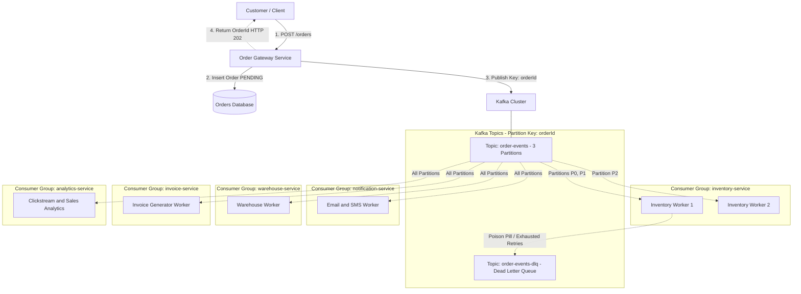
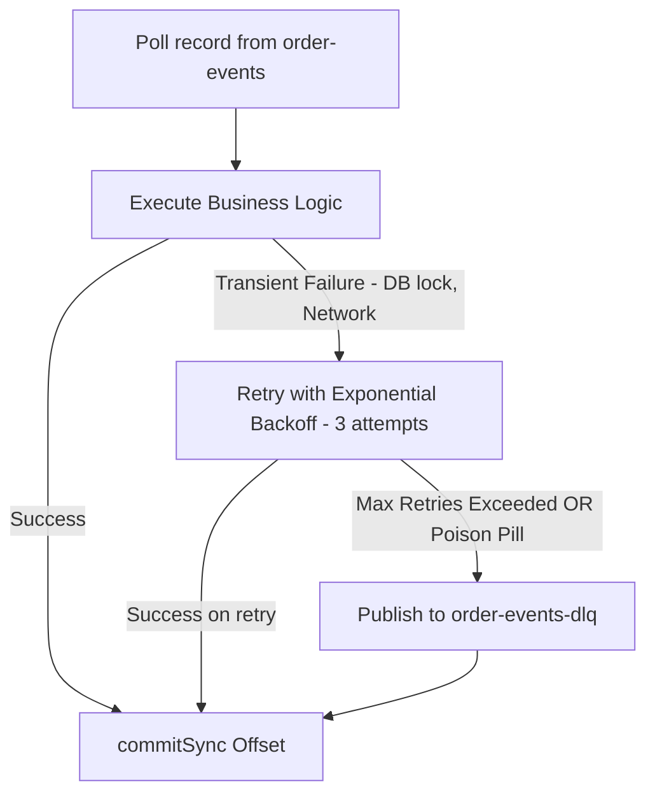

# Amazon Order Fulfillment Pipeline: System Design (HLD & LLD)

A real-world event-driven architecture using Apache Kafka to model an Amazon-scale order processing pipeline.

---

## Contents

- [1. Problem Statement & Requirements](#1-problem-statement--requirements)
  - [Functional Requirements](#functional-requirements)
  - [Non-Functional Requirements](#non-functional-requirements)
- [2. High-Level Design (HLD)](#2-high-level-design-hld)
  - [Synchronous Critical Path vs Asynchronous Fan-Out](#synchronous-critical-path-vs-asynchronous-fan-out)
  - [System Architecture Diagram](#system-architecture-diagram)
  - [Kafka Topic Strategy](#kafka-topic-strategy)
  - [Consumer Groups & Workload Distribution](#consumer-groups--workload-distribution)
- [3. Low-Level Design (LLD)](#3-low-level-design-lld)
  - [Domain Models & Event Schema](#domain-models--event-schema)
  - [Producer Design (Order Service)](#producer-design-order-service)
  - [Consumer Design & Processing Contracts](#consumer-design--processing-contracts)
  - [Failure Handling, Idempotency & Dead Letter Queue (DLQ)](#failure-handling-idempotency--dead-letter-queue-dlq)
- [4. Implementation Roadmap](#4-implementation-roadmap)

---

## 1. Problem Statement & Requirements

When a customer clicks **"Place Order"** on Amazon, the system must coordinate multiple downstream operations:

```
[User Click]
   │
   ├─► 1. Save Order to DB
   ├─► 2. Reduce Inventory
   ├─► 3. Send Confirmation Email
   ├─► 4. Send SMS
   ├─► 5. Notify Warehouse (Packing & Dispatch)
   ├─► 6. Generate Invoice (PDF & Billing)
   └─► 7. Update Real-Time Analytics
```

### Functional Requirements
1. **Order Ingestion**: Accept order submissions with customer details, items, pricing, and shipping address.
2. **Synchronous Confirmation**: User receives immediate feedback that their order has been placed (Order ID generated).
3. **Asynchronous Processing**:
   - Inventory is reserved.
   - Notifications (Email + SMS) are sent.
   - Warehouse packing slip is created.
   - Invoices are generated.
   - Business analytics counters are incremented.
4. **Independent Failure Isolation**: If the email service or SMS provider is slow or down, orders must **not** fail.
5. **Auditing & Replay**: Ability to reprocess events or replay historical orders for analytics and reconciliation.

### Non-Functional Requirements
1. **High Throughput & Low Latency**: Ingestion must respond in $< 50\text{ms}$.
2. **Order-Level Sequential Consistency**: All state transitions for a given order (e.g., `CREATED` $\rightarrow$ `INVENTORY_RESERVED` $\rightarrow$ `PAID` $\rightarrow$ `CANCELLED`) must be processed in chronological order.
3. **At-Least-Once Delivery & Idempotency**: Zero message loss. Downstream consumers must be idempotent to handle duplicate deliveries gracefully.
4. **Fault Tolerance**: If any consumer crashes, it must resume from its last committed offset without affecting other microservices.

---

## 2. High-Level Design (HLD)

### Synchronous Critical Path vs Asynchronous Fan-Out

The fundamental architectural principle: **Do the absolute bare minimum synchronously, and delegate everything else to Kafka asynchronously.**

| Stage | Execution Mode | Why? |
|---|---|---|
| **Save Order to DB** | Synchronous | Must ensure order record exists before confirming to user |
| **Publish to Kafka** | Synchronous / High-reliability (`acks=all`) | Must guarantee message is durable in Kafka before HTTP response |
| **Reduce Inventory** | Asynchronous | Handled by dedicated inventory consumer |
| **Email & SMS** | Asynchronous | External network I/O; must not block user checkout |
| **Warehouse Notification** | Asynchronous | Internal fulfillment process |
| **Invoice Generation** | Asynchronous | Heavy PDF/document generation |
| **Update Analytics** | Asynchronous | Non-critical path telemetry |

---

### System Architecture Diagram



---

### Kafka Topic Strategy

| Topic Name | Partitions | Replication Factor | Key | Payload Description |
|---|---|---|---|---|
| `order-events` | 3 (dev) / 24+ (prod) | 3 | `orderId` | Order lifecycle events (`CREATED`, `INVENTORY_RESERVED`, `FAILED`) |
| `order-events-dlq` | 1 | 3 | `orderId` | Poison-pill events that failed after retries + error metadata |

#### Why Partition Key = `orderId`?
- **Ordering Guarantee**: Kafka guarantees that $\text{hash}(\text{orderId}) \pmod N$ always maps to the same partition.
- Therefore, all events for `order_1001` are written sequentially to the same partition log, preventing race conditions (e.g., `ORDER_CANCELLED` being processed before `ORDER_CREATED`).

---

### Consumer Groups & Workload Distribution

Every downstream microservice operates as an **independent Consumer Group**. Kafka maintains separate offsets in `__consumer_offsets` for each group:

```
Topic: order-events (Partitions: P0, P1, P2)

Consumer Group: inventory-service (2 workers)
  ├── Worker 1 ──> Consumes P0, P1
  └── Worker 2 ──> Consumes P2

Consumer Group: notification-service (1 worker)
  └── Worker 1 ──> Consumes P0, P1, P2

Consumer Group: warehouse-service (1 worker)
  └── Worker 1 ──> Consumes P0, P1, P2

Consumer Group: invoice-service (1 worker)
  └── Worker 1 ──> Consumes P0, P1, P2

Consumer Group: analytics-service (1 worker)
  └── Worker 1 ──> Consumes P0, P1, P2
```

**Key Advantages:**
1. **Zero Coupling**: If the invoice generator is slow, it only builds lag for `invoice-service`. `inventory-service` and `notification-service` continue at full speed.
2. **Independent Scaling**: If inventory processing needs more throughput, scale `inventory-service` to 3 workers (1 worker per partition).

---

## 3. Low-Level Design (LLD)

### Domain Models & Event Schema

#### 1. Order Status Enum
```java
public enum OrderStatus {
    ORDER_CREATED,
    INVENTORY_RESERVED,
    PAYMENT_COMPLETED,
    WAREHOUSE_NOTIFIED,
    INVOICE_GENERATED,
    ORDER_FAILED
}
```

#### 2. Order Item Model
```java
public class OrderItem {
    private String productId;
    private String productName;
    private int quantity;
    private double unitPrice;
    
    // Constructors, Getters, Setters
}
```

#### 3. Core Event Payload (`OrderEvent`)
```java
public class OrderEvent {
    private String eventId;          // UUID for idempotency check
    private String orderId;          // Partition key
    private String customerId;
    private String customerEmail;
    private String customerPhone;
    private List<OrderItem> items;
    private double totalAmount;
    private OrderStatus status;
    private long timestamp;
    
    // Constructors, Getters, Setters
}
```

---

### Producer Design (Order Service)

The producer creates and dispatches events with high durability settings:

```
[HTTP Request] 
      │
      ▼
[OrderProducer]
      │
      ├─► Key: event.getOrderId()
      ├─► Value: JSON.serialize(event)
      ├─► acks = "all" (Waits for all in-sync replicas)
      ├─► enable.idempotence = true (Prevents duplicate sends on network retry)
      └─► ProducerRecord("order-events", orderId, jsonPayload)
```

**Producer Configuration Guidelines:**
- `acks=all`: No message lost even if the leader broker crashes.
- `enable.idempotence=true`: Broker deduplicates retries using PID + Sequence Number.
- `retries=Integer.MAX_VALUE`: Resilient against transient network blips.

---

### Consumer Design & Processing Contracts

Each consumer microservice implements an independent processing loop adhering to the **At-Least-Once** contract with **Manual Commits**:

```java
public interface OrderEventConsumer {
    void start();
    void processRecord(ConsumerRecord<String, String> record);
    void stop();
}
```

#### Consumer Execution Lifecycle:
```
1. poll(Duration.ofMillis(500))
      │
      ▼ (For each record in batch)
2. Deserialize JSON -> OrderEvent
      │
      ▼
3. Check Idempotency (Has eventId already been processed?)
      │
      ├── Yes ──► Skip processing (Duplicate safely ignored)
      └── No  ──► Execute Business Logic
                    ├── Inventory: decrementStock()
                    ├── Notification: sendEmail() & sendSms()
                    ├── Warehouse: generatePackingSlip()
                    └── Invoice: renderPdf()
      │
      ▼
4. consumer.commitSync()  <-- Commit offset ONLY upon success
```

---

### Failure Handling, Idempotency & Dead Letter Queue (DLQ)



#### 1. Idempotency Key
- Each event carries a unique `eventId` (UUID).
- Consumers record processed `eventId`s in their local database/cache:
  ```sql
  INSERT INTO processed_events (event_id, consumer_group, processed_at) VALUES (?, ?, NOW());
  ```
- If a consumer crashes before `commitSync()`, the replay will attempt to reprocess, hit the unique constraint, and safely skip execution without double-billing or double-shipping.

#### 2. Poison Pills & DLQ
- If an event contains malformed JSON, a negative quantity, or triggers an unrecoverable exception, retrying in a loop will cause **consumer lag to spike indefinitely** (head-of-line blocking).
- The consumer catches non-retryable errors, publishes the raw payload along with error stack traces to `order-events-dlq`, and commits the offset to keep the pipeline moving.

---

## 4. Implementation Roadmap

We will implement this pipeline incrementally in Java:

1. **Milestone 1**: Maven project setup with dependencies (`kafka-clients`, `jackson`). Domain models and JSON serializer/deserializer.
2. **Milestone 2**: `OrderEventProducer` with `orderId` key routing and async confirmation callbacks.
3. **Milestone 3**: `InventoryConsumerWorker` with manual commit (`commitSync`) and idempotency checks.
4. **Milestone 4**: Parallel consumer group demonstration (`NotificationConsumerWorker` and `WarehouseConsumerWorker`).
5. **Milestone 5**: Error handling interceptor and Dead Letter Queue (`order-events-dlq`).

