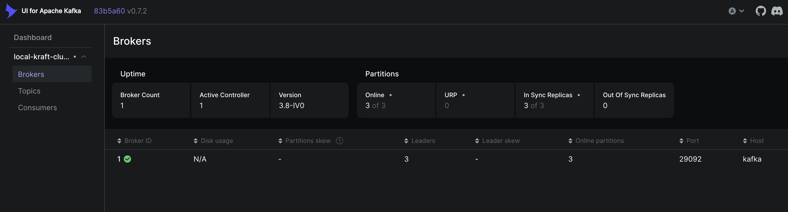
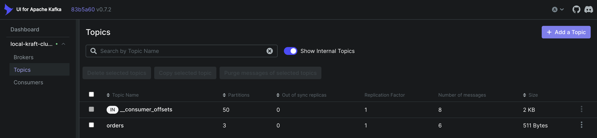
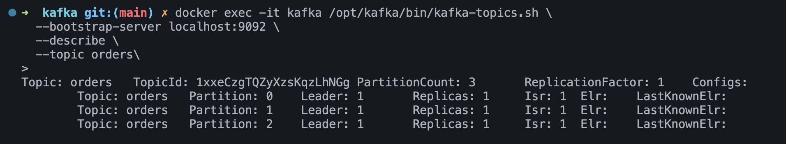
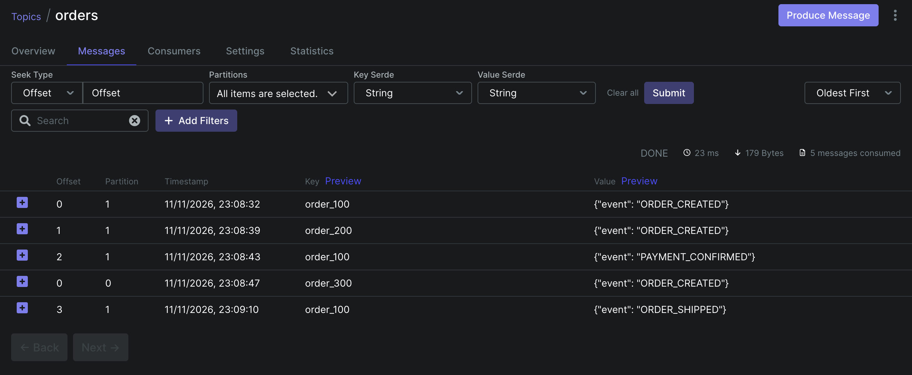
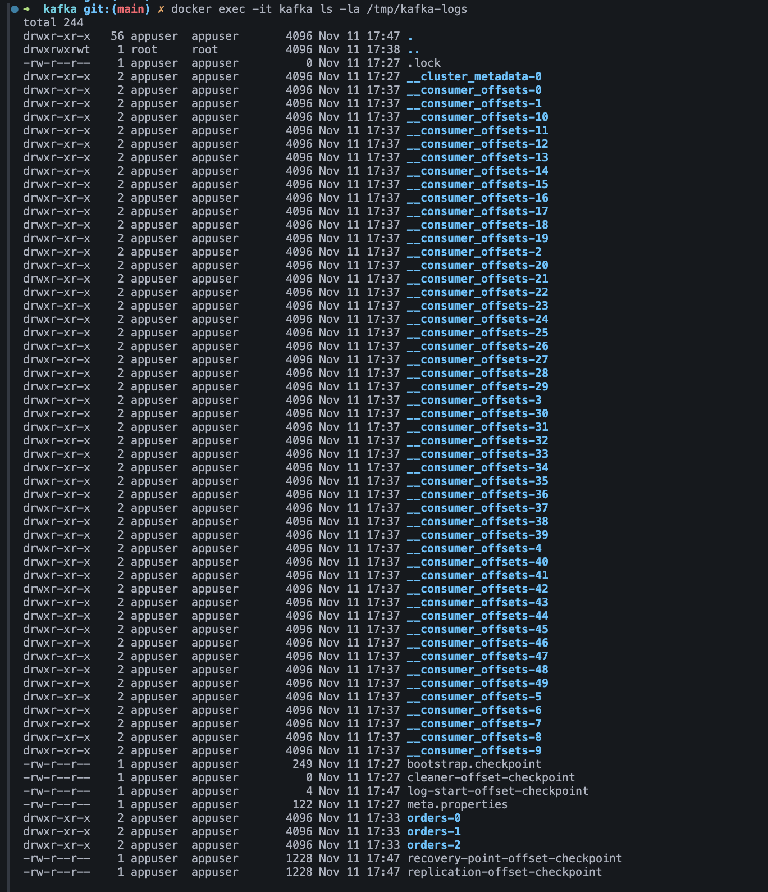
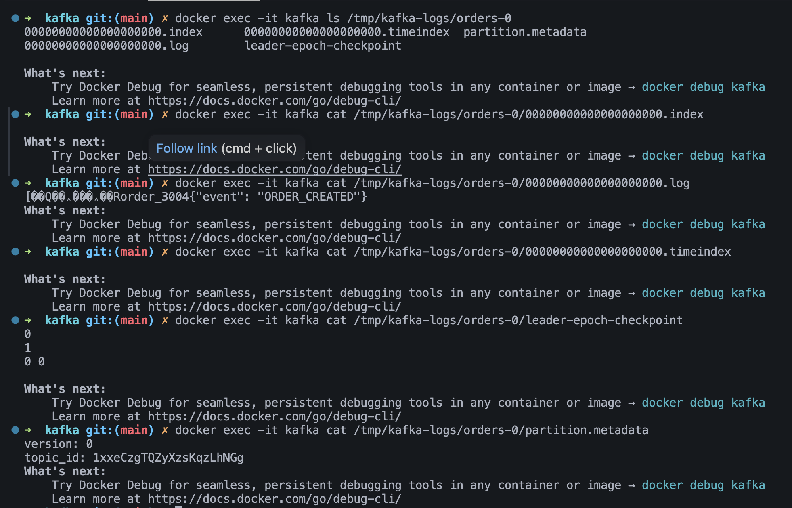
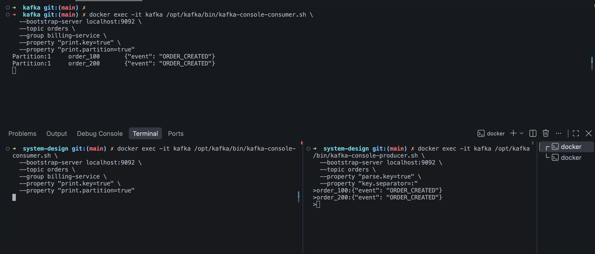

# Kafka Hands-On Lab Setup

This lab runs a single-node **Apache Kafka with KRaft** (no ZooKeeper) and **Kafka UI** for visual inspection.

---

## 1. Start the Environment

Run inside this directory (`implementations/kafka`):

```bash
docker compose up -d
```

- **Kafka Broker**: Available on `localhost:9092`
- **Kafka UI Web Dashboard**: Open [http://localhost:8080](http://localhost:8080) in your browser

To stop:
```bash
docker compose down
```



---

## 2. Essential CLI Practice & Concept Verification

Run these Kafka CLI commands to see the core concepts from the notes in action.

### A. Create a Topic with 3 Partitions
```bash
docker exec -it kafka /opt/kafka/bin/kafka-topics.sh \
  --bootstrap-server localhost:9092 \
  --create \
  --topic orders \
  --partitions 3 \
  --replication-factor 1
```



### B. Inspect Topic Metadata
```bash
docker exec -it kafka /opt/kafka/bin/kafka-topics.sh \
  --bootstrap-server localhost:9092 \
  --describe \
  --topic orders
```



### C. Produce Keyed Messages (Test Partition Hashing)
```bash
docker exec -it kafka /opt/kafka/bin/kafka-console-producer.sh \
  --bootstrap-server localhost:9092 \
  --topic orders \
  --property "parse.key=true" \
  --property "key.separator=:"
```

Type keyed events (press Enter after each):
```text
>order_100:{"event": "ORDER_CREATED"}
>order_200:{"event": "ORDER_CREATED"}
>order_100:{"event": "PAYMENT_CONFIRMED"}
>order_300:{"event": "ORDER_CREATED"}
>order_100:{"event": "ORDER_SHIPPED"}
```

*(Press `Ctrl + C` to exit the producer)*

### D. Consume and Verify Partition Placement & Ordering
```bash
docker exec -it kafka /opt/kafka/bin/kafka-console-consumer.sh \
  --bootstrap-server localhost:9092 \
  --topic orders \
  --from-beginning \
  --property "print.key=true" \
  --property "print.partition=true" \
  --property "print.offset=true" \
  --property "print.timestamp=true"
```

Notice that all events with `order_100` land on the **exact same partition** in strictly chronological order (`ORDER_CREATED` -> `PAYMENT_CONFIRMED` -> `ORDER_SHIPPED`).



---

## 3. Physical Storage Inspection on Disk

Verify how Kafka stores segment logs and indexes on the filesystem:

### A. List Topic Partition Directories
```bash
docker exec -it kafka ls -la /tmp/kafka-logs
```



### B. Inspect Files Inside a Partition Directory (`orders-0`)
```bash
docker exec -it kafka ls -la /tmp/kafka-logs/orders-0
```

Inspect segment contents and indexes:
```bash
docker exec -it kafka cat /tmp/kafka-logs/orders-0/00000000000000000000.index
docker exec -it kafka cat /tmp/kafka-logs/orders-0/00000000000000000000.log
docker exec -it kafka cat /tmp/kafka-logs/orders-0/00000000000000000000.timeindex
docker exec -it kafka cat /tmp/kafka-logs/orders-0/leader-epoch-checkpoint
docker exec -it kafka cat /tmp/kafka-logs/orders-0/partition.metadata
```



- `.log`: The actual sequential message records.
- `.index`: Sparse index mapping message offsets to physical byte offsets in the `.log` file for fast seek.
- `.timeindex`: Maps record timestamps to offsets for time-based lookups.

---

## 4. Consumer Groups & Partition Assignment in Action

Test how Kafka balances partitions among multiple consumers in the same consumer group.

### Terminal 1: Start Consumer 1 in `billing-service`
```bash
docker exec -it kafka /opt/kafka/bin/kafka-console-consumer.sh \
  --bootstrap-server localhost:9092 \
  --topic orders \
  --group billing-service \
  --property "print.key=true" \
  --property "print.partition=true"
```

### Terminal 2: Start Consumer 2 in the same `billing-service` Group
```bash
docker exec -it kafka /opt/kafka/bin/kafka-console-consumer.sh \
  --bootstrap-server localhost:9092 \
  --topic orders \
  --group billing-service \
  --property "print.key=true" \
  --property "print.partition=true"
```



**Key Observations:**
- When Consumer 1 was active, it processed messages.
- When Consumer 2 joined the same group (`billing-service`), a rebalance occurred. The partitions were split between them.
- Neither consumer received duplicate messages because Kafka guarantees that each partition is assigned to **at most one consumer** within a single consumer group.

---

## 5. Next Step: Hands-On Interview Project

We will build the **Order Event Streaming Pipeline** together following standard interview stages:
1. **Requirements & Scope** (Functional & Non-Functional)
2. **HLD (High-Level Design)**: Architecture diagram, topic strategy, consumer groups
3. **LLD (Low-Level Design)**: Models, Producer contract, Consumer interfaces, Error/Retry strategies
4. **Implementation & Skeletons**: You write the core logic; we test against this local cluster!
