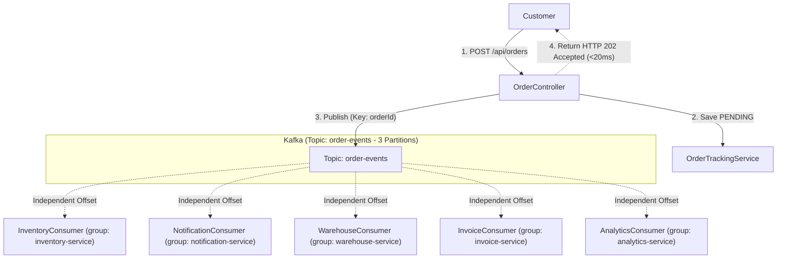
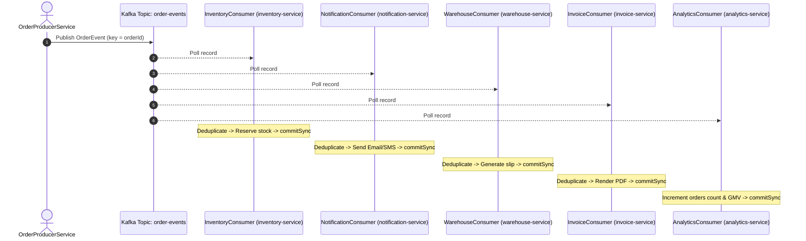

# Amazon Order Pipeline: Project Overview & Code Walkthrough

A comprehensive guide explaining the entire Spring Boot + Kafka project from first principles.

---

## Contents

- [1. The Problem We Are Solving](#1-the-problem-we-are-solving)
- [2. Spring Boot Core Concepts (Mental Model)](#2-spring-boot-core-concepts-mental-model)
- [3. Complete Directory & File Structure](#3-complete-directory--file-structure)
- [4. Step-by-Step Execution Flow](#4-step-by-step-execution-flow)
  - [Step 1: Ingress (HTTP Request)](#step-1-ingress-http-request)
  - [Step 2: API Gateway Layer (`OrderController`)](#step-2-api-gateway-layer-ordercontroller)
  - [Step 3: Kafka Producer Layer (`OrderProducerService`)](#step-3-kafka-producer-layer-orderproducerservice)
  - [Step 4: Asynchronous Fan-Out (5 Independent Consumer Groups)](#step-4-asynchronous-fan-out-5-independent-consumer-groups)
  - [Step 5: Dead Letter Queue (DLQ) Resilience](#step-5-dead-letter-queue-dlq-resilience)
- [5. How Components Map to System Design Concepts](#5-how-components-map-to-system-design-concepts)
- [6. Running & Testing Locally](#6-running--testing-locally)

---

## 1. The Problem We Are Solving

When a customer clicks **"Place Order"** on Amazon, 7 distinct operations must occur:

```
[Customer Click: Place Order]
       │
       ├─► 1. Save Order to Database
       ├─► 2. Reserve / Reduce Inventory Stock
       ├─► 3. Send Confirmation Email
       ├─► 4. Send SMS Dispatch Alert
       ├─► 5. Notify Warehouse (Packing Slip)
       ├─► 6. Generate Tax Invoice (PDF)
       └─► 7. Increment Real-Time Analytics (GMV)
```

### The Synchronous Mistake (Chained HTTP Calls)
```
User -> Order API -> Inventory API -> Email API -> SMS API -> Warehouse API ...
```
- **Latency is additive**: If each service takes 100ms, the user waits 700ms+.
- **Cascading failures**: If the SMS gateway is down, the entire order fails.
- **Tight coupling**: The checkout service must know the network endpoint of every downstream team.

### The Event-Driven Solution (Our Architecture)


The user gets an immediate confirmation. Downstream microservices consume the event in parallel at their own pace without blocking each other.

---

## 2. Spring Boot Core Concepts (Mental Model)

In plain Java, you would have to write raw network sockets, manage worker thread pools, instantiate objects with `new`, and write manual `while(true) { consumer.poll(...) }` loops.

Spring Boot automates this via **Inversion of Control (IoC)** and **Annotations**:

| Annotation | Purpose | How We Use It |
|---|---|---|
| `@SpringBootApplication` | Entry point of the app | Bootstraps the application context and scans for components |
| `@RestController` | Marks an HTTP API controller | Listens for incoming HTTP POST/GET requests from customers |
| `@Service` | Marks a business logic class | Houses business logic (e.g. stock calculation, email sending) |
| `@Configuration` | Infrastructure setup | Defines Kafka topics to be automatically provisioned on the broker |
| `@Bean` | Method-level component factory | Tells Spring, *"Register the object returned by this method as a managed component"* |
| `@KafkaListener` | Declarative consumer | Runs a background thread poll-loop for a specific consumer group |
| `@Payload` & `@Header` | Injects message data | Injects deserialized JSON payload and Kafka metadata (partition, offset) into method arguments |

---

## 3. Complete Directory & File Structure

All files reside inside:
`implementations/kafka/amazon-order-pipeline/`

```
amazon-order-pipeline/
├── pom.xml                                  # Maven dependencies (Spring Boot, Spring Kafka, Jackson)
│
├── src/main/resources/
│   └── application.yml                      # Configuration (broker URL, serializers, ack-mode)
│
└── src/main/java/com/systemdesign/orderpipeline/
    ├── OrderPipelineApplication.java        # Main entry point (@SpringBootApplication)
    │
    ├── config/
    │   └── KafkaTopicConfig.java            # Declares 'order-events' & 'order-events-dlq' topics
    │
    ├── model/                               # Data Transfer Objects (DTOs) & Enums
    │   ├── OrderStatus.java                 # Enum: ORDER_CREATED, INVENTORY_RESERVED, etc.
    │   ├── OrderItem.java                   # Line item POJO (productId, quantity, price)
    │   ├── OrderEvent.java                  # Main Kafka event payload (key: orderId, dedupe: eventId)
    │   ├── CreateOrderRequest.java          # Inbound JSON body from customer POST /api/orders
    │   ├── OrderResponse.java               # Outbound JSON acknowledgment (HTTP 202)
    │   ├── OrderStatusResponse.java         # Outbound JSON for GET /api/orders/{id}/status
    │   ├── AnalyticsSummaryResponse.java    # Outbound JSON for GET /api/analytics/summary
    │   └── DeadLetterEvent.java             # Poison-pill payload routed to DLQ
    │
    ├── controller/                          # REST Endpoints
    │   ├── OrderController.java             # POST /api/orders & GET /api/orders/{id}/status
    │   └── AnalyticsController.java         # GET /api/analytics/summary
    │
    ├── producer/                            # Kafka Publishing Layer
    │   ├── OrderProducerService.java        # Publishes OrderEvent with orderId as partition key
    │   └── DeadLetterQueueProducer.java     # Publishes poison-pills to DLQ topic
    │
    ├── consumer/                            # 5 Independent Consumer Groups + 1 DLQ Monitor
    │   ├── InventoryConsumer.java           # Group: "inventory-service"
    │   ├── NotificationConsumer.java        # Group: "notification-service"
    │   ├── WarehouseConsumer.java           # Group: "warehouse-service"
    │   ├── InvoiceConsumer.java             # Group: "invoice-service"
    │   ├── AnalyticsConsumer.java           # Group: "analytics-service"
    │   └── DeadLetterQueueConsumer.java     # Group: "dlq-monitoring-service"
    │
    └── service/                             # Business Logic & In-Memory State Stores
        ├── InventoryStockService.java       # Thread-safe product stock manager
        ├── EmailNotificationService.java    # Email dispatcher simulation
        ├── SmsNotificationService.java      # SMS gateway simulation
        ├── WarehouseFulfillmentService.java # Packing slip generator
        ├── BillingInvoiceService.java       # Tax invoice generator
        ├── RealtimeAnalyticsService.java    # Atomic counter for order count and GMV
        └── OrderTrackingService.java        # In-memory order status repository
```

---

## 4. Step-by-Step Execution Flow

### Step 1: Ingress (HTTP Request)
A client sends an HTTP request to place an order:
```http
POST /api/orders HTTP/1.1
Host: localhost:8081
Content-Type: application/json

{
  "customerId": "cust_101",
  "customerEmail": "john@example.com",
  "customerPhone": "+1234567890",
  "items": [
    {
      "productId": "prod_apple_iphone",
      "productName": "iPhone 16 Pro",
      "quantity": 1,
      "unitPrice": 999.0
    }
  ],
  "totalAmount": 999.0
}
```

---

### Step 2: API Gateway Layer (`OrderController`)
Located at: `controller/OrderController.java`

1. Spring deserializes the incoming JSON body into a `CreateOrderRequest` object.
2. The controller:
   - Generates a business `orderId` (e.g. `ord_a1b2c3d4`).
   - Generates a UUID `eventId` (used by consumers for deduplication / idempotency).
   - Records the initial status `ORDER_CREATED` in `OrderTrackingService`.
   - Packages the data into an `OrderEvent` payload.
3. Passes the event to `OrderProducerService`.
4. Returns an immediate **HTTP 202 Accepted** with an `OrderResponse` to the customer.

```java
// Synchronous Critical Path finishes in < 20ms
orderTrackingService.updateStatus(orderId, OrderStatus.ORDER_CREATED);
orderProducerService.sendOrderEvent(event);
return ResponseEntity.status(HttpStatus.ACCEPTED).body(response);
```

---

### Step 3: Kafka Producer Layer (`OrderProducerService`)
Located at: `producer/OrderProducerService.java`

1. Injects Spring's `KafkaTemplate<String, OrderEvent>`.
2. Sends the event to the topic `order-events`:
   ```java
   kafkaTemplate.send(ORDER_EVENTS_TOPIC, event.getOrderId(), event);
   ```
3. **Partition Key**: Notice that `event.getOrderId()` is passed as the message key.
   - Kafka hashes the key: `hash(orderId) % 3`.
   - All subsequent events for `ord_a1b2c3d4` (e.g. status updates) will always land on the **exact same partition in strict chronological order**.
4. Uses non-blocking callbacks (`CompletableFuture.whenComplete`) to log partition and offset when the Kafka broker acknowledges the write.

---

### Step 4: Asynchronous Fan-Out (5 Independent Consumer Groups)
Kafka receives the event on `order-events` and delivers a copy to each registered **Consumer Group**.

Each consumer group has its own committed offset in `__consumer_offsets`. They run in parallel:



#### Consumer Details:
1. **`InventoryConsumer`** (`groupId = "inventory-service"`):
   - Checks `processedEvents.add(eventId)` (idempotency guard against duplicate delivery).
   - Reserves product quantities in `InventoryStockService`.
   - Calls `acknowledgment.acknowledge()` to manually commit offset to Kafka.
2. **`NotificationConsumer`** (`groupId = "notification-service"`):
   - Dispatches confirmation emails and SMS dispatch alerts.
   - Commits offset independently. If email gateway is slow, it will **not** slow down inventory or warehouse.
3. **`WarehouseConsumer`** (`groupId = "warehouse-service"`):
   - Generates packing slips for fulfillment center workers.
4. **`InvoiceConsumer`** (`groupId = "invoice-service"`):
   - Generates tax invoice PDF documents.
5. **`AnalyticsConsumer`** (`groupId = "analytics-service"`):
   - Updates atomic metrics counters (Total Orders and Gross Merchandise Value).
   - Data can be queried anytime via `GET /api/analytics/summary`.

---

### Step 5: Dead Letter Queue (DLQ) Resilience
Located at: `producer/DeadLetterQueueProducer.java` & `consumer/DeadLetterQueueConsumer.java`

- If an event contains malformed data or fails after retries, instead of crashing the consumer loop (head-of-line blocking), it is wrapped into a `DeadLetterEvent` and published to `order-events-dlq`.
- `DeadLetterQueueConsumer` (`groupId = "dlq-monitoring-service"`) monitors the DLQ topic for alerts and auditing.

---

## 5. How Components Map to System Design Concepts

| System Design Concept | Implementation in Code |
|---|---|
| **Critical Path vs Fan-out** | `OrderController` returns HTTP 202 in $<20\text{ms}$; 5 consumer groups handle the remaining steps asynchronously |
| **Partition-level Ordering** | `OrderProducerService` passes `orderId` as key $\rightarrow$ $\text{hash}(\text{key}) \pmod N$ preserves order per order |
| **At-Least-Once Delivery** | `application.yml` sets `ack-mode: manual_immediate`; consumers invoke `acknowledgment.acknowledge()` post-processing |
| **Idempotency Guard** | `processedEvents.add(eventId)` prevents duplicate stock deduction if a consumer crashes before commit |
| **Independent Offsets** | Each consumer specifies a distinct `groupId`; Kafka tracks separate offsets in `__consumer_offsets` |
| **Dead Letter Queue (DLQ)** | Poison pills routed to `order-events-dlq` via `DeadLetterQueueProducer` |
| **Automated Topic Provisioning** | `KafkaTopicConfig` provisions `order-events` (3 partitions) and `order-events-dlq` (1 partition) |

---

## 6. Running & Testing Locally

### 1. Start Kafka Cluster
Ensure the Docker containers are running:
```bash
cd implementations/kafka/docker
docker compose up -d
```
- Kafka Broker: `localhost:9092`
- Kafka UI: [http://localhost:8080](http://localhost:8080)

### 2. Run the Spring Boot Application
```bash
cd implementations/kafka/amazon-order-pipeline
mvn spring-boot:run
```
*(Or run `OrderPipelineApplication.java` in your IDE).*

### 3. Place an Order (Terminal / Postman)
```bash
curl -X POST http://localhost:8081/api/orders \
  -H "Content-Type: application/json" \
  -d '{
    "customerId": "cust_101",
    "customerEmail": "alice@example.com",
    "customerPhone": "+1234567890",
    "items": [
      {
        "productId": "prod_apple_iphone",
        "productName": "iPhone 16 Pro",
        "quantity": 1,
        "unitPrice": 999.0
      }
    ],
    "totalAmount": 999.0
  }'
```

### 4. Check Analytics Summary
```bash
curl http://localhost:8081/api/analytics/summary
```

### 5. Check Order Status
```bash
curl http://localhost:8081/api/orders/<orderId>/status
```

### 6. Observe in Kafka UI
Open [http://localhost:8080](http://localhost:8080):
- **Topics**: Check `order-events` message log and partition assignment.
- **Consumer Groups**: Check offsets and lag across `inventory-service`, `notification-service`, `warehouse-service`, `invoice-service`, and `analytics-service`.
